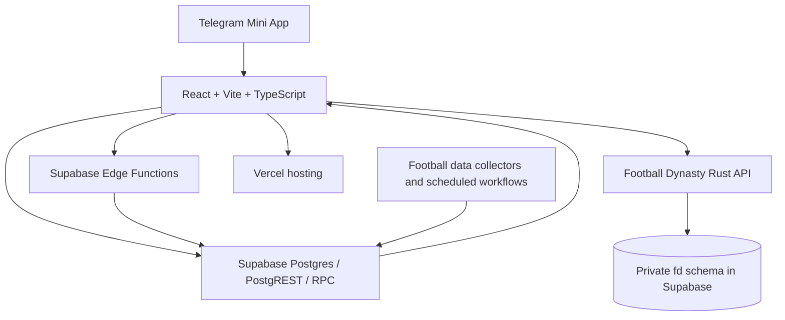

# Sherlock Scholes — Project Execution Map

> **Purpose:** keep the team focused on shipping a better football product and collecting trustworthy football data. This is an execution map, not a chronological work diary.
>
> **Last structure review:** 2026-11-12  
> **Canonical product:** Telegram Mini App — https://sherlock-scholes.vercel.app  
> **Repository:** https://github.com/Aloews/sherlock-scholes-  
> **Legacy map:** [Archived 2026-11-11](archive/MAP-2026-11-11-pre-outcome-rewrite.md)

## 1. Mission and product outcomes

Sherlock Scholes is a football product built around play, discovery, real football data, and useful analysis. Every engineering task must move at least one measurable product outcome:

1. **Play:** users can start and finish a game reliably, invite others, and return.
2. **Discover:** users can explore players, clubs, competitions, matches, and football stories.
3. **Understand:** player and team information is accurate, sourced, current, and comparable.
4. **Predict:** forecasts for matches, individual awards, and team competitions are calibrated against outcomes.
5. **Contribute:** users can create amateur football spaces without being able to alter other users' data.

A feature is not complete because its screen exists. It is complete when its user path works in production, its data is trustworthy, its failure states are handled, and its usage or quality can be measured.

## 2. Current product architecture

- **Frontend:** React, Vite, TypeScript, Feature-Sliced Design; route ownership is in `src/app/Router.tsx`.
- **Primary data platform:** the existing Supabase project. Real football data, Alias game data, and Football Dynasty fictional campaign data are separate domains.
- **Backend boundary:** existing features use Supabase RPC/PostgREST and Edge Functions. Football Dynasty has its own Rust/Axum API and private `fd` schema.
- **Alias Rust migration:** `services/sherlock-core/` contains the pure domain for phase transitions, clock, room planning, round lifecycle, filters, and room codes. The authenticated Rust/Axum API now owns the runtime endpoints for round planning, ending, and explainer voice pause/resume. Round planning uses the verified Telegram identity and shared Rust core. Round completion is claimed and scored directly in a single Rust-owned PostgreSQL transaction, with membership row-locking, idempotent score upsert, next-round lookup, and final-room statistics trigger. Voice pause/resume use atomic database updates and explainer ownership checks, capped at 120 seconds. The legacy `end_round` and global `sweep_stale_rooms` SECURITY DEFINER RPCs are revoked from `PUBLIC`, `anon`, `authenticated`, and `service_role`; the postgres owner retains the cron-only sweep path. The frontend uses these endpoints in Preview and production; local development retains the TypeScript round-plan parity fallback. Supabase remains the persistence layer and realtime event source.
- **Alias lifecycle verification:** `supabase/tests/alias_round_lifecycle_setup.sql` and `supabase/tests/alias_round_lifecycle.test.sql` exercise the production SQL contracts against disposable PostgreSQL. Rust API integration tests additionally call the authenticated round-end/pause/resume routes against that fixture, including non-member denial, explainer-only access, idempotency, persisted pause state, and score writes. The timestamped pause/resume correction is applied in the same CI job.
- **Shared room-code contract:** `contracts/alias_room_code_cases.json` is consumed by TypeScript and Rust tests. It locks short legacy codes, ASCII-only normalization, case-preserving field input, Telegram `start`/`startapp` links, percent decoding, malformed URLs, and invalid inputs to one cross-language behavior set.
- **Shared round-plan contract:** `contracts/alias_round_plan_cases.json` is consumed by the TypeScript fallback and Rust core tests. The Rust API integration tests verify Telegram authentication, input bounds, 1v1 host ordering, team roster rotation, and invalid-request rejection.
- **Hosting:** Vercel hosts the Mini App and the currently configured backend routing. Do not assume a Railway migration is complete unless the deployed service and production routes have been verified.
- **Scheduled collection:** GitHub Actions, Supabase Cron, and collector code. A successful job invocation does not prove that the upstream source returned complete or fresh data.

## 2.1 Vercel free-plan budget and release batching

**Hard constraint:** Vercel's free-plan build/deployment allowance is a scarce release resource. Do not spend it on routine commits, tiny fixes, repeated previews, or retries of an unchanged build.

- Do implementation, formatting, static analysis, unit tests, integration tests, and broad regression checks in the local/CI environment first. GitHub Actions and local test execution are not a reason to trigger a Vercel deployment.
- Build a **substantial, coherent vertical slice** before asking Vercel to build it: implementation, related migrations/contracts, tests, documentation, and reviewable acceptance criteria belong to one planned batch. Keep commits logically ordered, but do not use a Vercel build as a per-commit test.
- Avoid pushing intermediate states to a Vercel-connected preview branch when each push would trigger a build. Before starting a batch, inspect the repository's actual Vercel Git integration and ignored-build configuration. Use an approved skip/ignore mechanism for intermediate commits only when its behavior is verified; never guess at configuration or silently change production settings.
- **Repository-enforced preview gate:** the linked `sherlock-scholes` project is on the Hobby plan. Because this repository defines multiple Vercel services, `vercel.json` sets the ignore command separately for the frontend and Football Dynasty service roots. Production deployments and `main` always build; non-main branches are ignored unless the commit message contains the explicit `[vercel-preview]` marker. Missing branch and environment metadata fails open; when Vercel identifies a Preview but omits the branch, the script skips it unless the explicit marker is present. The policy is covered by a Node test and is version-controlled. The service-level commands in `vercel.json` are the repository configuration; Vercel's deployment log confirmed the frontend command ran for the planned Preview. For routine commits, Vercel still starts a short preflight deployment process to run the ignore command, then cancels before dependency installation and the application build. This avoids full builds but is not zero Vercel platform activity. No separate project-level setting is assumed. Do not change the service commands without checking the actual service configuration.
- Trigger **one deliberate Preview build** after the batch passes local and GitHub checks. Use that deployment for the complete end-to-end acceptance pass, not for debugging individual lines.
- Promote/deploy to Production only after Preview acceptance, required CI, database/security checks, and the release checklist pass. Verify the deployed commit and critical Telegram journey.
- If Vercel reports a quota/rate-limit failure, do not repeatedly retry the same deployment or create extra commits merely to retry it. Preserve the code, diagnose through local builds, GitHub Actions and available logs, and wait for the allowance/reset or an explicitly approved alternative release path.
- Do not disable required GitHub CI, weaken tests, or mark a Vercel failure as success to save quota. Keep Vercel build failures distinct from source/test failures.
- Record each intentional Vercel Preview/Production build and its purpose in the release record. No routine status update or documentation-only commit should consume a Vercel build.

**Acceptance:** intermediate implementation and verification do not require Vercel builds; a Vercel build is reserved for a complete, already-verified release candidate.

## 2.2 Large-batch implementation and deep verification protocol

The user-facing delivery unit is a complete, coherent feature slice—not a stream of tiny deployments. Build the slice end-to-end before spending deployment quota, while keeping source changes internally reviewable and tests authored with the behavior.

1. **Inspect first:** read this map, the relevant product specification, current source and tests, callers/contracts, migrations/RLS, open PRs, CI and the affected production behavior. Record unknowns; do not infer unseen state.
2. **Define the whole slice:** list user-visible scenarios, API/data contracts, authorization boundaries, failure states, migration/rollback needs, acceptance criteria and explicit non-goals. Avoid bundling unrelated features.
3. **Implement the coherent slice:** make the full intended path work across UI/API/database/jobs as applicable. Add regression tests with the code; do not leave stubs, dead routes, duplicate implementations, or placeholder success responses.
4. **First verification pass:** run formatting, type/compiler checks, lint/Clippy, focused unit tests, integration/contract tests, database migration and RLS tests, and relevant existing regressions. Include boundary, invalid-input, empty/missing-data, failure/retry, idempotency, concurrency and authorization cases where applicable.
5. **Quality-tool pass (ub-mode):** follow `.agents/skills/ub-mode/SKILL.md`. Use Crapper to target CRAP < 10 per function, Dryer to find structural duplication at similarity >= 0.8, and Mutator to find uncovered behavior, surviving mutants and dead code. Capture actual output. If a tool is unavailable, record that exact limitation; do not claim it ran or silently waive the project gate.
6. **Second independent verification pass:** after fixing all findings, rerun the complete relevant suite from a clean state against the exact candidate commit. Reinspect the final diff, generated artifacts, migration order, test output and CI results. A test run before the final code change does not validate the final code.
7. **Runtime/artifact verification:** use REA per `.agents/skills/rea/SKILL.md` when conclusions require a packaged build, live runtime or artifact behavior not established by source. REA is not a substitute for source tests, and its local MCP setup must not be assumed installed. Verify the actual Telegram Mini App user path in Preview after the single planned Vercel build.
8. **Release gate:** all required checks must pass on the exact commit; no unexplained red checks, known critical defects, data-integrity failures or unverified deployment claims. If a gate is blocked by infrastructure/quota, report it as blocked—not passed—and do not merge/deploy around it.

**Test evidence must identify:** exact commit SHA, command/workflow, environment, pass/fail result, relevant coverage/mutation output, and any untested surface. “Build succeeded” alone is not deep verification.

## 3. Delivery scoreboard

Update this section only from measured evidence. Every metric must include an observation timestamp and a source query, workflow, or dashboard.

| Outcome | Metric | Latest evidence in repository history | Status |
|---|---|---|---|
| Player discovery | Active cards with portraits / total active cards | 17,867 / 27,231 on 2026-11-07 12:50 UTC | Baseline is stale; remeasure |
| Player statistics | `player_season_stat` row count and latest `fetched_at` | 866,057 rows; latest fetch 2026-11-07 13:07 UTC | Collection is active in that snapshot; remeasure |
| Profile enrichment | Queue depth, success, no-data, retryable failures by source | 23,408 jobs on 2026-11-07 13:07 UTC | Transfermarkt had persistent zero-byte HTTP 202 responses; remeasure |
| Forecast quality | Brier score, log loss, calibration, coverage, baseline comparison | No current unified scorecard recorded here | Missing evidence |
| Player awards | Candidate coverage, feature freshness, calibrated probabilities, outcome evaluation | Snapshot tables and pipeline exist; current calibration not verified here | Needs measured evaluation |
| Team competitions | Tournament candidate coverage, calibrated probabilities, outcome evaluation | Snapshot tables and pipeline exist; current calibration not verified here | Needs measured evaluation |
| Reliability | Production release health, failed scheduled jobs, API readiness | Historical snapshots are dated 2026-11-07 | Remeasure before changing priorities |
| Product usage | Active users, game starts/completions, invitations, retention | No current baseline recorded here | Instrument and measure |

**Important:** the numbers above are historical evidence, not claims about today's production state. Never copy them forward as current values. Refresh the scoreboard before planning a data or reliability sprint.

## 4. Product areas and ownership map

| Product area | User outcome | Main entry points | Completion evidence |
|---|---|---|---|
| Home and navigation | Reach a useful football activity quickly | `src/screens/HomeScreen.tsx`, `src/app/Router.tsx` | Main journeys are discoverable; route and deep-link tests pass |
| Football Alias | Create/join a room and finish a multiplayer game | `src/screens`, `src/features/lobby`, game features, staged Rust domain in `services/sherlock-core/` | Host/guest lifecycle, reconnect, replay, and room expiry pass end-to-end; Rust runtime parity is proven before cutover |
| Player cards and profiles | Identify a player and inspect a reliable career record | `src/features/cards`, collection/profile screens | Identity, portrait provenance, career totals, and season totals reconcile |
| Clubs and squads | Inspect club identity, squad, form, and matches | `src/features/clubs`, club screens | Squad source, coverage, match sample size, and timestamps are visible and consistent |
| Matches and competitions | Follow fixtures, results, tables, and tournaments | `src/features/matches`, match/table screens | Fixtures and results reconcile; incomplete coverage is not presented as a full table |
| Statistics and ratings | Compare players on consistent definitions | `src/features/ratings`, statistics screens | One documented metric definition; no season/career mixing or duplicate pipelines |
| Forecasts | Make measurable predictions and learn from outcomes | `src/features/forecast`, `football_scraper/`, forecast tables | Time-correct snapshots, calibrated probabilities, settled outcomes, and benchmark reports |
| Awards and tournament analytics | Estimate likely award winners and competition outcomes | Candidate snapshot tables and forecast pipelines | Pre-event predictions are stored, evaluated out-of-sample, and calibrated |
| Fantasy | Build a team using the same trusted football statistics | `src/features/fantasy`, fantasy screens | Fantasy scoring reconciles to canonical match/player statistics |
| News and digest | Find relevant football stories with clear source attribution | `src/features/digest`, news screens | Source links, timestamps, deduplication, and clear separation of articles from video |
| Amateur football | Create and manage a private amateur league | `src/features/amateur`, `amateur-logo` Edge Function | Telegram identity verification, owner isolation, upload validation |
| Football Dynasty | Play a persistent fictional football dynasty campaign | `src/features/football-dynasty`, `src/screens/FootballDynastyScreen.tsx`, `services/football-dynasty` | Campaign lifecycle, ledger integrity, succession, persistence, and owner isolation |
| Admin and operations | Maintain data and resolve production issues safely | `src/screens/admin`, `docs/operations` | Audited changes, bounded jobs, observable failures, tested rollback |

This is a navigation index, not a promise that every listed area is currently complete. Verify implementation and production state before extending an area.

## 5. Data platform: source of truth and collection

### 5.1 Rules

- Every displayed football fact must have a defined source, identity mapping, observation time, and meaning.
- Never treat a successful HTTP response or queue status as proof that a player, club, squad, or statistic was successfully identified.
- Never replace a verified portrait or statistic with an unverified candidate.
- Keep **career totals**, **season totals**, and **single-match statistics** separate.
- Keep **real-world football entities** separate from fictional Football Dynasty entities.
- A missing value is not zero. An incomplete squad is not a complete squad. A partial set of player appearances is not a full league table.
- Store source provenance and fetch timestamps so stale data can be detected and corrected.

### 5.2 Core data domains

| Domain | Main relations / concepts | Required quality checks |
|---|---|---|
| Player identity and cards | `cards`, `players`, source identity mappings | Duplicate identities, ambiguous matches, active status, portrait provenance |
| Match-level performance | `player_match_stats`, fixtures and match relations | Match identity, player identity, duplicate rows, score and minutes sanity |
| Season performance | `player_season_stat`, season identifiers | Season boundaries, competition scope, team changes, source freshness |
| Clubs and squads | `football_club`, `club_roster`, `soccerwiki_player`, `club_match` | Squad completeness, effective dates, source disagreement, player movement |
| Market estimates | Market-value snapshots and source observations | Comparable dates, currency, age/league/position context, source confidence |
| Awards | `award_candidate_snapshot` and associated evaluation data | Only pre-award inputs; no leakage from future results |
| Team tournaments | `team_tournament_candidate_snapshot` and associated evaluation data | Tournament state, qualification, draw, injuries/availability where supported |
| Forecasts | Prediction snapshots, outcomes, calibration and error records | Timestamped probabilities, settled labels, baselines, calibration by horizon |

### 5.3 Collection pipeline

For each source, track:
1. **Coverage:** how many expected entities or competitions can be identified.
2. **Freshness:** age of the newest successful observation.
3. **Yield:** new verified facts written per run, not just jobs completed.
4. **Quality:** identity match rate, duplicate rate, field validation, and source conflicts.
5. **Cost and failure:** requests, runtime, rate limits, retries, blocked responses, and manual intervention.

A collector is healthy only when it produces net new, identity-verified data at an acceptable cost and freshness. A queue that repeatedly retries an upstream block is not progress.

## 6. Forecasting and analytics standard

All prediction systems must use one evaluation contract.

- Save the exact information available at prediction time.
- Store model version, feature version, prediction horizon, event/competition identity, probabilities, and creation time.
- Do not train or evaluate with information that became available after the prediction timestamp.
- Compare against transparent baselines (for example, market-implied probability where legally and technically available, simple historical frequency, or a naive benchmark).
- Report Brier score and log loss for probabilistic predictions; report calibration by probability bucket and sample size.
- Separate **coverage** (how often the model predicts) from **quality** (how accurate its predictions are).
- For abstaining models, report both quality on covered cases and coverage. Never compare them only on accuracy.
- Evaluate by competition, forecast horizon, season, and sample size. Do not claim superiority from a tiny sample.
- Personal awards and team tournaments must use the same principles but distinct feature sets and target definitions.

**Release gate:** no forecast feature is labelled accurate or calibrated until an out-of-sample evaluation report, sample size, baseline, and calibration result are available.

## 7. Football Dynasty boundary

Football Dynasty is a fictional management simulation inside Sherlock Scholes, not a source of real football statistics.

- Product specification: `docs/football-dynasty/GDD.md`
- Technical architecture: `docs/football-dynasty/ARCHITECTURE.md`
- Current implementation/release notes: `docs/football-dynasty/IMPLEMENTATION_PLAN.md`
- Rust API: `services/football-dynasty/`
- Frontend API and screen: `src/features/football-dynasty/`, `src/screens/FootballDynastyScreen.tsx`
- Persistence: private Supabase `fd` schema, owner-scoped through verified Telegram identity.
- Never write fictional players, clubs, competitions, or match results into the real football catalogue.
- The current implemented slice is campaign creation and a bounded founder/heir succession lifecycle. It is not the full management simulation described in the GDD.

## 8. Execution priorities

Work in this order. Reorder only when fresh production evidence shows a higher-impact blocker.

### P0 — Restore a reliable shipping and measurement loop

**Outcome:** every week produces a user-visible improvement or a verified data-quality/reliability fix.

- Establish a current production baseline for release health, core journeys, active users, game starts/completions, collection yield, and forecast quality.
- Identify the smallest production blocker that prevents a feature or data pipeline from shipping.
- Deliver one complete, coherent vertical slice at a time. Keep its commits reviewable and ordered, but batch implementation before broad verification and reserve Vercel builds for the release candidate.
- Remove stale or contradictory roadmap items; do not keep multiple competing implementations alive.
- Maintain a weekly shipped-outcome log with links to PRs, deployments, tests, and measured impact.

**Exit criteria:** the baseline exists; the top blockers have owners and acceptance tests; the next deliverable can be released without bundling unrelated refactors.

### P1 — Increase the amount of trustworthy football data

**Outcome:** materially more verified player, squad, match, and season data is available to product features.

- Measure coverage gaps by competition, club, season, and player—not only total row counts.
- Prioritise sources by verified yield and reliability. Do not blindly increase request volume against blocked sources.
- Resolve stale leases, retry loops, source-specific failures, identity mismatches, and incomplete squad ingestion.
- Preserve existing verified photos and records; fill missing data without destructive replacement.
- Publish a collection report after each bounded run: attempted, verified new, updated, unchanged, rejected, retryable, and permanently unavailable.

**Exit criteria:** measurable net growth in verified coverage, freshness within an agreed window, and no increase in duplicate or identity-error rates.

### P2 — Unify football statistics and market estimates

**Outcome:** every screen and model uses the same definitions and canonical facts.

- Establish canonical definitions for career totals, season totals, match totals, appearances, minutes, goals, assists, and market-value observations.
- Reconcile source conflicts and team/competition scope.
- Ensure player cards, ratings, fantasy, forecasts, and club screens consume the same canonical layer.
- Add regression tests for known player/club discrepancies before changing production calculations.

**Exit criteria:** agreed discrepancy cases pass; no screen silently substitutes season totals for career totals; every displayed metric has a definition and provenance.

### P3 — Ship calibrated player-award and team-tournament forecasts

**Outcome:** the product can rank plausible winners before an event and show how those predictions performed afterwards.

- Define targets and prediction horizons for each award and tournament.
- Build leakage-safe candidate snapshots from information available at prediction time.
- Produce probability distributions, not unsupported deterministic rankings.
- Backtest by historical season and competition; compare with simple baselines.
- Store final outcomes and publish calibration, Brier score, log loss, coverage, and sample sizes.
- Surface uncertainty and missing data in the UI.

**Exit criteria:** reproducible out-of-sample evaluation and a production monitoring path exist for both personal awards and team competitions.

### P4 — Expand product features from measured demand

**Outcome:** new features increase meaningful usage rather than adding disconnected screens.

- Prioritise features that improve a core journey: play, discover, understand, predict, or contribute.
- Require a one-sentence user problem, a production acceptance path, a data dependency check, and a success metric before implementation.
- Prefer one complete vertical slice over several partially integrated features.
- Defer cosmetic refactors unless they remove a measured usability problem or unblock delivery.

**Exit criteria:** each feature is used by a real user path and has a metric that can confirm or reject its value.

## 9. Definition of done

A task is done only when all applicable items are true:

- [ ] User outcome and acceptance criteria are explicit.
- [ ] Existing code, data, and production behaviour were inspected before changes.
- [ ] One canonical implementation is used; no parallel duplicate pipeline was added.
- [ ] Authorization, ownership, and data provenance are enforced server-side.
- [ ] Tests cover success, failure, boundary, and regression cases.
- [ ] The complete first-pass and independent second-pass test suites pass on the exact commit being released.
- [ ] Applicable ub-mode Crapper/Dryer/Mutator evidence is recorded; unavailable tools are explicitly identified.
- [ ] No intermediate Vercel build was used for routine validation; the planned Preview build is reserved for the verified release candidate.
- [ ] Deployment is verified against the intended commit and production URL.
- [ ] Critical user journey is smoke-tested in the real Telegram Mini App.
- [ ] Data freshness, collection yield, or feature usage is measured where relevant.
- [ ] Documentation reflects the deployed code, not an intended future state.

Do not report a task as complete based only on code being merged, a workflow being green, or a deployment being marked ready.

## 10. Repository navigation

| Need | Start here |
|---|---|
| Route registration and app shell | `src/app/Router.tsx`, `src/app/` |
| Screens | `src/screens/` |
| Domain features and API clients | `src/features/` |
| Shared UI, hooks, utilities | `src/shared/` |
| Supabase schema and migrations | `supabase/migrations/` |
| Edge Functions | `supabase/functions/` |
| Football data collection and analytics | `football_scraper/`, `scripts/`, `docs/*.py` |
| Rust Football Dynasty service | `services/football-dynasty/` |
| Product specification | `docs/football-dynasty/GDD.md`, feature-specific specs |
| Technical constraints | `docs/ARCHITECTURE.md` |
| Content rights and attribution | `docs/CONTENT_RIGHTS.md` |
| Historical production investigations | `docs/archive/MAP-2026-11-11-pre-outcome-rewrite.md` |

Do not scan the entire repository by default. Start with the relevant entry point, feature API, database contract, and tests. Expand the search only when the code contradicts this map or a dependency is not listed.

## 11. Working agreement for AI agents and contributors

1. Read this map and the relevant feature specification before implementation.
2. Inspect the current branch, open PRs, CI, migrations, production state, and recent deployments before changing anything.
3. State the expected user outcome and acceptance criteria in the PR.
4. Implement the smallest complete vertical slice.
5. Finish the planned coherent implementation batch, then run deep verification and a clean second pass as specified in §2.2.
6. Inspect the actual diff and test output; fix failures rather than explaining them away. Re-run the full relevant suite after the final fix.
7. Preserve Vercel free-plan allowance: no Preview/Production build for intermediate commits or routine checks. Use one planned Preview for the verified batch, then Production only after acceptance.
8. Apply ub-mode for engineering discipline and REA only for artifact/runtime evidence; verify tool availability and retain actual outputs.
9. Verify production behaviour and data impact after deployment.
10. Update this map only when architecture, ownership, a release gate, or a measured priority changes. Do not append routine audit logs here.
11. Put dated investigations, raw counts, incident timelines, and detailed query output in a dedicated operational report under `docs/archive/` or `docs/operations/`.
12. Never invent metrics, claim unverified deployment success, weaken tests to get a green check, or delete production data to make a dashboard look healthy.

## 12. Immediate next deliverables

These are the next outcomes to prove—not a promise that work is already complete:

1. **Fresh baseline:** remeasure production deployment, key user journeys, player/photo/stat coverage, collection yield, cron and GitHub workflow failures, and database capacity.
2. **Data recovery plan:** turn the largest verified collection gaps into bounded, source-specific fixes with measurable net-new data targets.
3. **Canonical analytics contract:** document and test the shared definitions used by cards, ratings, fantasy, player awards, and team tournament forecasts.
4. **Forecast evaluation report:** produce the first leakage-safe, out-of-sample scorecard for individual awards and team competitions.
5. **Feature delivery cadence:** ship one complete, measurable user-facing vertical slice at a time; do not let infrastructure cleanup consume the entire release cycle.

**Priority rule:** if a task does not improve a user journey, increase verified data coverage/freshness, improve measured prediction quality, or remove a demonstrated production blocker, it is not a top-priority task.
