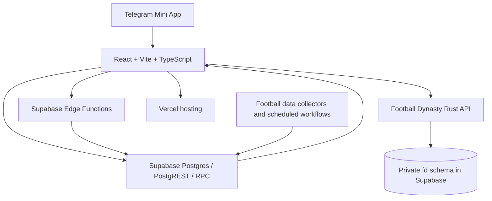

# Sherlock Scholes — Project Execution Map

> **Purpose:** keep the team focused on shipping a better football product and collecting trustworthy football data. This is an execution map, not a chronological work diary.
>
> **Last structure review:** 2026-11-11  
> **Canonical product:** Telegram Mini App — https://sherlock-scholes.vercel.app  
> **Repository:** https://github.com/Aloews/sherlock-scholes-  
> **Legacy map:** [Archived 2026-11-11](archive/MAP-2026-11-11-pre-outcome-rewrite.md)

## 1. Mission and product outcomes

Sherlock Scholes is a football product built around play, discovery, real football data, and useful analysis. Every engineering task must move at least one measurable product outcome:

1. **Play:** users can start and finish a game reliably, invite others, and return.
2. **Discover:** users can explore players, clubs, competitions, matches, and football stories.
3. **Understand:** player and team information is accurate, sourced, current, and comparable.
4. **Predict:** forecasts for matches, individual awards, and team competitions are calibrated against outcomes.
5. **Contribute:** users can create amateur football spaces without being able to alter other users' data.

A feature is not complete because its screen exists. It is complete when its user path works in production, its data is trustworthy, its failure states are handled, and its usage or quality can be measured.

## 2. Current product architecture

- **Frontend:** React, Vite, TypeScript, Feature-Sliced Design; route ownership is in `src/app/Router.tsx`.
- **Primary data platform:** the existing Supabase project. Real football data, Alias game data, and Football Dynasty fictional campaign data are separate domains.
- **Backend boundary:** existing features use Supabase RPC/PostgREST and Edge Functions. Football Dynasty has its own Rust/Axum API and private `fd` schema.
- **Hosting:** Vercel hosts the Mini App and the currently configured backend routing. Do not assume a Railway migration is complete unless the deployed service and production routes have been verified.
- **Scheduled collection:** GitHub Actions, Supabase Cron, and collector code. A successful job invocation does not prove that the upstream source returned complete or fresh data.

## 3. Delivery scoreboard

Update this section only from measured evidence. Every metric must include an observation timestamp and a source query, workflow, or dashboard.

| Outcome | Metric | Latest evidence in repository history | Status |
|---|---|---|---|
| Player discovery | Active cards with portraits / total active cards | 17,867 / 27,231 on 2026-11-07 12:50 UTC | Baseline is stale; remeasure |
| Player statistics | `player_season_stat` row count and latest `fetched_at` | 866,057 rows; latest fetch 2026-11-07 13:07 UTC | Collection is active in that snapshot; remeasure |
| Profile enrichment | Queue depth, success, no-data, retryable failures by source | 23,408 jobs on 2026-11-07 13:07 UTC | Transfermarkt had persistent zero-byte HTTP 202 responses; remeasure |
| Forecast quality | Brier score, log loss, calibration, coverage, baseline comparison | No current unified scorecard recorded here | Missing evidence |
| Player awards | Candidate coverage, feature freshness, calibrated probabilities, outcome evaluation | Snapshot tables and pipeline exist; current calibration not verified here | Needs measured evaluation |
| Team competitions | Tournament candidate coverage, calibrated probabilities, outcome evaluation | Snapshot tables and pipeline exist; current calibration not verified here | Needs measured evaluation |
| Reliability | Production release health, failed scheduled jobs, API readiness | Historical snapshots are dated 2026-11-07 | Remeasure before changing priorities |
| Product usage | Active users, game starts/completions, invitations, retention | No current baseline recorded here | Instrument and measure |

**Important:** the numbers above are historical evidence, not claims about today's production state. Never copy them forward as current values. Refresh the scoreboard before planning a data or reliability sprint.

## 4. Product areas and ownership map

| Product area | User outcome | Main entry points | Completion evidence |
|---|---|---|---|
| Home and navigation | Reach a useful football activity quickly | `src/screens/HomeScreen.tsx`, `src/app/Router.tsx` | Main journeys are discoverable; route and deep-link tests pass |
| Football Alias | Create/join a room and finish a multiplayer game | `src/screens`, `src/features/lobby`, game features | Host/guest lifecycle, reconnect, replay, and room expiry pass end-to-end |
| Player cards and profiles | Identify a player and inspect a reliable career record | `src/features/cards`, collection/profile screens | Identity, portrait provenance, career totals, and season totals reconcile |
| Clubs and squads | Inspect club identity, squad, form, and matches | `src/features/clubs`, club screens | Squad source, coverage, match sample size, and timestamps are visible and consistent |
| Matches and competitions | Follow fixtures, results, tables, and tournaments | `src/features/matches`, match/table screens | Fixtures and results reconcile; incomplete coverage is not presented as a full table |
| Statistics and ratings | Compare players on consistent definitions | `src/features/ratings`, statistics screens | One documented metric definition; no season/career mixing or duplicate pipelines |
| Forecasts | Make measurable predictions and learn from outcomes | `src/features/forecast`, `football_scraper/`, forecast tables | Time-correct snapshots, calibrated probabilities, settled outcomes, and benchmark reports |
| Awards and tournament analytics | Estimate likely award winners and competition outcomes | Candidate snapshot tables and forecast pipelines | Pre-event predictions are stored, evaluated out-of-sample, and calibrated |
| Fantasy | Build a team using the same trusted football statistics | `src/features/fantasy`, fantasy screens | Fantasy scoring reconciles to canonical match/player statistics |
| News and digest | Find relevant football stories with clear source attribution | `src/features/digest`, news screens | Source links, timestamps, deduplication, and clear separation of articles from video |
| Amateur football | Create and manage a private amateur league | `src/features/amateur`, `amateur-logo` Edge Function | Telegram identity verification, owner isolation, upload validation |
| Football Dynasty | Play a persistent fictional football dynasty campaign | `src/features/football-dynasty`, `src/screens/FootballDynastyScreen.tsx`, `services/football-dynasty` | Campaign lifecycle, ledger integrity, succession, persistence, and owner isolation |
| Admin and operations | Maintain data and resolve production issues safely | `src/screens/admin`, `docs/operations` | Audited changes, bounded jobs, observable failures, tested rollback |

This is a navigation index, not a promise that every listed area is currently complete. Verify implementation and production state before extending an area.

## 5. Data platform: source of truth and collection

### 5.1 Rules

- Every displayed football fact must have a defined source, identity mapping, observation time, and meaning.
- Never treat a successful HTTP response or queue status as proof that a player, club, squad, or statistic was successfully identified.
- Never replace a verified portrait or statistic with an unverified candidate.
- Keep **career totals**, **season totals**, and **single-match statistics** separate.
- Keep **real-world football entities** separate from fictional Football Dynasty entities.
- A missing value is not zero. An incomplete squad is not a complete squad. A partial set of player appearances is not a full league table.
- Store source provenance and fetch timestamps so stale data can be detected and corrected.

### 5.2 Core data domains

| Domain | Main relations / concepts | Required quality checks |
|---|---|---|
| Player identity and cards | `cards`, `players`, source identity mappings | Duplicate identities, ambiguous matches, active status, portrait provenance |
| Match-level performance | `player_match_stats`, fixtures and match relations | Match identity, player identity, duplicate rows, score and minutes sanity |
| Season performance | `player_season_stat`, season identifiers | Season boundaries, competition scope, team changes, source freshness |
| Clubs and squads | `football_club`, `club_roster`, `soccerwiki_player`, `club_match` | Squad completeness, effective dates, source disagreement, player movement |
| Market estimates | Market-value snapshots and source observations | Comparable dates, currency, age/league/position context, source confidence |
| Awards | `award_candidate_snapshot` and associated evaluation data | Only pre-award inputs; no leakage from future results |
| Team tournaments | `team_tournament_candidate_snapshot` and associated evaluation data | Tournament state, qualification, draw, injuries/availability where supported |
| Forecasts | Prediction snapshots, outcomes, calibration and error records | Timestamped probabilities, settled labels, baselines, calibration by horizon |

### 5.3 Collection pipeline

For each source, track:
1. **Coverage:** how many expected entities or competitions can be identified.
2. **Freshness:** age of the newest successful observation.
3. **Yield:** new verified facts written per run, not just jobs completed.
4. **Quality:** identity match rate, duplicate rate, field validation, and source conflicts.
5. **Cost and failure:** requests, runtime, rate limits, retries, blocked responses, and manual intervention.

A collector is healthy only when it produces net new, identity-verified data at an acceptable cost and freshness. A queue that repeatedly retries an upstream block is not progress.

## 6. Forecasting and analytics standard

All prediction systems must use one evaluation contract.

- Save the exact information available at prediction time.
- Store model version, feature version, prediction horizon, event/competition identity, probabilities, and creation time.
- Do not train or evaluate with information that became available after the prediction timestamp.
- Compare against transparent baselines (for example, market-implied probability where legally and technically available, simple historical frequency, or a naive benchmark).
- Report Brier score and log loss for probabilistic predictions; report calibration by probability bucket and sample size.
- Separate **coverage** (how often the model predicts) from **quality** (how accurate its predictions are).
- For abstaining models, report both quality on covered cases and coverage. Never compare them only on accuracy.
- Evaluate by competition, forecast horizon, season, and sample size. Do not claim superiority from a tiny sample.
- Personal awards and team tournaments must use the same principles but distinct feature sets and target definitions.

**Release gate:** no forecast feature is labelled accurate or calibrated until an out-of-sample evaluation report, sample size, baseline, and calibration result are available.

## 7. Football Dynasty boundary

Football Dynasty is a fictional management simulation inside Sherlock Scholes, not a source of real football statistics.

- Product specification: `docs/football-dynasty/GDD.md`
- Technical architecture: `docs/football-dynasty/ARCHITECTURE.md`
- Current implementation/release notes: `docs/football-dynasty/IMPLEMENTATION_PLAN.md`
- Rust API: `services/football-dynasty/`
- Frontend API and screen: `src/features/football-dynasty/`, `src/screens/FootballDynastyScreen.tsx`
- Persistence: private Supabase `fd` schema, owner-scoped through verified Telegram identity.
- Never write fictional players, clubs, competitions, or match results into the real football catalogue.
- The current implemented slice is campaign creation and a bounded founder/heir succession lifecycle. It is not the full management simulation described in the GDD.

## 8. Execution priorities

Work in this order. Reorder only when fresh production evidence shows a higher-impact blocker.

### P0 — Restore a reliable shipping and measurement loop

**Outcome:** every week produces a user-visible improvement or a verified data-quality/reliability fix.

- Establish a current production baseline for release health, core journeys, active users, game starts/completions, collection yield, and forecast quality.
- Identify the smallest production blocker that prevents a feature or data pipeline from shipping.
- Keep changes small enough to review and deploy independently.
- Remove stale or contradictory roadmap items; do not keep multiple competing implementations alive.
- Maintain a weekly shipped-outcome log with links to PRs, deployments, tests, and measured impact.

**Exit criteria:** the baseline exists; the top blockers have owners and acceptance tests; the next deliverable can be released without bundling unrelated refactors.

### P1 — Increase the amount of trustworthy football data

**Outcome:** materially more verified player, squad, match, and season data is available to product features.

- Measure coverage gaps by competition, club, season, and player—not only total row counts.
- Prioritise sources by verified yield and reliability. Do not blindly increase request volume against blocked sources.
- Resolve stale leases, retry loops, source-specific failures, identity mismatches, and incomplete squad ingestion.
- Preserve existing verified photos and records; fill missing data without destructive replacement.
- Publish a collection report after each bounded run: attempted, verified new, updated, unchanged, rejected, retryable, and permanently unavailable.

**Exit criteria:** measurable net growth in verified coverage, freshness within an agreed window, and no increase in duplicate or identity-error rates.

### P2 — Unify football statistics and market estimates

**Outcome:** every screen and model uses the same definitions and canonical facts.

- Establish canonical definitions for career totals, season totals, match totals, appearances, minutes, goals, assists, and market-value observations.
- Reconcile source conflicts and team/competition scope.
- Ensure player cards, ratings, fantasy, forecasts, and club screens consume the same canonical layer.
- Add regression tests for known player/club discrepancies before changing production calculations.

**Exit criteria:** agreed discrepancy cases pass; no screen silently substitutes season totals for career totals; every displayed metric has a definition and provenance.

### P3 — Ship calibrated player-award and team-tournament forecasts

**Outcome:** the product can rank plausible winners before an event and show how those predictions performed afterwards.

- Define targets and prediction horizons for each award and tournament.
- Build leakage-safe candidate snapshots from information available at prediction time.
- Produce probability distributions, not unsupported deterministic rankings.
- Backtest by historical season and competition; compare with simple baselines.
- Store final outcomes and publish calibration, Brier score, log loss, coverage, and sample sizes.
- Surface uncertainty and missing data in the UI.

**Exit criteria:** reproducible out-of-sample evaluation and a production monitoring path exist for both personal awards and team competitions.

### P4 — Expand product features from measured demand

**Outcome:** new features increase meaningful usage rather than adding disconnected screens.

- Prioritise features that improve a core journey: play, discover, understand, predict, or contribute.
- Require a one-sentence user problem, a production acceptance path, a data dependency check, and a success metric before implementation.
- Prefer one complete vertical slice over several partially integrated features.
- Defer cosmetic refactors unless they remove a measured usability problem or unblock delivery.

**Exit criteria:** each feature is used by a real user path and has a metric that can confirm or reject its value.

## 9. Definition of done

A task is done only when all applicable items are true:

- [ ] User outcome and acceptance criteria are explicit.
- [ ] Existing code, data, and production behaviour were inspected before changes.
- [ ] One canonical implementation is used; no parallel duplicate pipeline was added.
- [ ] Authorization, ownership, and data provenance are enforced server-side.
- [ ] Tests cover success, failure, boundary, and regression cases.
- [ ] Relevant CI checks pass on the exact commit being released.
- [ ] Deployment is verified against the intended commit and production URL.
- [ ] Critical user journey is smoke-tested in the real Telegram Mini App.
- [ ] Data freshness, collection yield, or feature usage is measured where relevant.
- [ ] Documentation reflects the deployed code, not an intended future state.

Do not report a task as complete based only on code being merged, a workflow being green, or a deployment being marked ready.

## 10. Repository navigation

| Need | Start here |
|---|---|
| Route registration and app shell | `src/app/Router.tsx`, `src/app/` |
| Screens | `src/screens/` |
| Domain features and API clients | `src/features/` |
| Shared UI, hooks, utilities | `src/shared/` |
| Supabase schema and migrations | `supabase/migrations/` |
| Edge Functions | `supabase/functions/` |
| Football data collection and analytics | `football_scraper/`, `scripts/`, `docs/*.py` |
| Rust Football Dynasty service | `services/football-dynasty/` |
| Product specification | `docs/football-dynasty/GDD.md`, feature-specific specs |
| Technical constraints | `docs/ARCHITECTURE.md` |
| Content rights and attribution | `docs/CONTENT_RIGHTS.md` |
| Historical production investigations | `docs/archive/MAP-2026-11-11-pre-outcome-rewrite.md` |

Do not scan the entire repository by default. Start with the relevant entry point, feature API, database contract, and tests. Expand the search only when the code contradicts this map or a dependency is not listed.

## 11. AI agent as an implementation partner

The AI assistant is an active engineering contributor, not a review-only gate. Its responsibility is to help move work from a verified requirement to a working, tested deliverable.

### 11.1 What the assistant can do

- **Understand and plan:** inspect the relevant repository code, project map, specifications, migrations, open issues/PRs, CI results, deployment configuration, and available operational evidence; identify dependencies, risks, and acceptance criteria.
- **Design:** propose and refine architecture, API contracts, database schemas, data models, user flows, error handling, security boundaries, and rollout/rollback plans.
- **Implement:** write and edit application code, SQL migrations, tests, scripts, configuration, and documentation; refactor existing code; fix compiler, lint, test, integration, and runtime failures; update the project map when the operating model or architecture changes.
- **Work across the stack:** contribute to the React/TypeScript frontend, Rust/Axum services, Python tooling and collectors, PostgreSQL/Supabase, Edge Functions, CI workflows, and deployment configuration where the repository and connected tools provide access.
- **Verify:** run or trigger the checks available in the current environment, inspect their actual logs and outputs, review diffs, trace failures to root causes, and repeat the fix-and-test cycle.
- **Deliver:** create branches and commits, prepare pull requests, review CI, and verify deployments when the required repository/hosting access and explicit release authorization are available.

### 11.2 The assistant owns the result; models and agents are tools

- The assistant remains responsible for the technical direction, integration, review, and truthful completion report.
- Starimg models (including Fable 5.2) and other coding agents may be used to accelerate bounded implementation tasks. They are optional workers, not the only way work can be completed.
- If a model produces malformed code, stale-context patches, incomplete files, or failing tests, the assistant must diagnose the failure and may rewrite the affected code directly using the available repository tools or execution environment. It must not endlessly resubmit the same failed patch.
- Generated code is untrusted until it is integrated, reviewed, and passes the relevant checks. A model's claim that work is complete is not evidence.
- Delegate only tasks with explicit file scope, acceptance criteria, constraints, and verification commands. Keep the main implementation coherent; do not allow multiple agents to overwrite the same files concurrently.

### 11.3 Execution and safety boundaries

- Prefer completing the implementation in the current working branch and delivering a reviewable PR over sending the user a checklist of manual coding steps.
- If direct shell execution is unavailable, use the connected repository/CI/hosting tools that can perform the required work. State any capability gap precisely; do not pretend that a command was run.
- Never expose secrets in source, logs, commits, prompts, or reports. Use configured secret stores and verify secret presence without printing secret values.
- Do not apply production migrations, modify production data, merge PRs, incur paid usage, or deploy product changes unless the user has authorized that action. Read-only inspection and isolated test environments should be preferred.
- If an external dependency or permission genuinely blocks implementation, identify the exact blocker and the smallest action needed; continue all independent work instead of stopping at an audit.
- The final report must distinguish implemented changes, verified checks, unverified items, and production impact. Never call a task complete while required checks are failing or unavailable.

## 12. Working agreement for AI agents and contributors

1. Read this map and the relevant feature specification before implementation.
2. Inspect the current branch, open PRs, CI, migrations, production state, and recent deployments before changing anything.
3. State the expected user outcome and acceptance criteria in the PR.
4. Implement the smallest complete vertical slice.
5. Run targeted tests first, then required repository checks.
6. Inspect the actual diff and test output; fix failures rather than explaining them away.
7. Verify production behaviour and data impact after deployment.
8. Update this map only when architecture, ownership, a release gate, or a measured priority changes. Do not append routine audit logs here.
9. Put dated investigations, raw counts, incident timelines, and detailed query output in a dedicated operational report under `docs/archive/` or `docs/operations/`.
10. Never invent metrics, claim unverified deployment success, weaken tests to get a green check, or delete production data to make a dashboard look healthy.

## 13. Immediate next deliverables

These are the next outcomes to prove—not a promise that work is already complete:

1. **Fresh baseline:** remeasure production deployment, key user journeys, player/photo/stat coverage, collection yield, cron and GitHub workflow failures, and database capacity.
2. **Data recovery plan:** turn the largest verified collection gaps into bounded, source-specific fixes with measurable net-new data targets.
3. **Canonical analytics contract:** document and test the shared definitions used by cards, ratings, fantasy, player awards, and team tournament forecasts.
4. **Forecast evaluation report:** produce the first leakage-safe, out-of-sample scorecard for individual awards and team competitions.
5. **Feature delivery cadence:** ship one complete, measurable user-facing vertical slice at a time; do not let infrastructure cleanup consume the entire release cycle.

**Priority rule:** if a task does not improve a user journey, increase verified data coverage/freshness, improve measured prediction quality, or remove a demonstrated production blocker, it is not a top-priority task.
