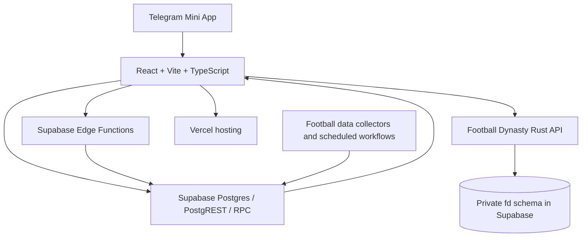

# Sherlock Scholes — Project Execution Map

> **Purpose:** keep the team focused on shipping a better football product and collecting trustworthy football data. This is an execution map, not a chronological work diary.
>
> **Last structure review:** 2026-11-11  
> **Canonical product:** Telegram Mini App — https://sherlock-scholes.vercel.app  
> **Repository:** https://github.com/Aloews/sherlock-scholes-  
> **Legacy map:** [Archived 2026-11-11](archive/MAP-2026-11-11-pre-outcome-rewrite.md)

## 1. Mission and product outcomes

Sherlock Scholes is a football product built around play, discovery, real football data, and useful analysis. Every engineering task must move at least one measurable product outcome:

1. **Play:** users can start and finish a game reliably, invite others, and return.
2. **Discover:** users can explore players, clubs, competitions, matches, and football stories.
3. **Understand:** player and team information is accurate, sourced, current, and comparable.
4. **Predict:** forecasts for matches, individual awards, and team competitions are calibrated against outcomes.
5. **Contribute:** users can create amateur football spaces without being able to alter other users' data.

A feature is not complete because its screen exists. It is complete when its user path works in production, its data is trustworthy, its failure states are handled, and its usage or quality can be measured.

## 2. Current product architecture

- **Frontend:** React, Vite, TypeScript, Feature-Sliced Design; route ownership is in `src/app/Router.tsx`.
- **Primary data platform:** the existing Supabase project. Real football data, Alias game data, and Football Dynasty fictional campaign data are separate domains.
- **Backend boundary:** existing features use Supabase RPC/PostgREST and Edge Functions. Football Dynasty has its own Rust/Axum API and private `fd` schema.
- **Hosting:** Vercel hosts the Mini App and the currently configured backend routing. Do not assume a Railway migration is complete unless the deployed service and production routes have been verified.
- **Scheduled collection:** GitHub Actions, Supabase Cron, and collector code. A successful job invocation does not prove that the upstream source returned complete or fresh data.

## 3. Delivery scoreboard

Snapshot measured **2026-11-23 UTC** using read-only Supabase aggregates, GitHub Actions, Vercel deployment metadata, and `cron.job_run_details`. Refresh before the next delivery decision.

| Outcome | Metric | Latest evidence | Source query / workflow | Status |
|---|---|---|---|---|
| Player portraits | Active player + women cards with photo URL: **19,217 / 25,810 (74.45%)**; 6,593 missing. All active cards: 20,549 / 27,370 (75.1%). | URLs present only; image reachability not revalidated | `cards`: active/category/photo_url/photo_source | Coverage still incomplete |
| Season stats | **885,205** rows; 24,802 cards; 98 seasons; latest fetch Nov 22. **346,795** rows refreshed since Nov 16. | Refresh count is not net-new | `player_season_stat`: count, distinct card_id/season_id, max/count `fetched_at` | High coverage; provenance needed for net-new |
| Match stats | **309,189** rows; 14,800 players; 3,382 match dates; 6,822 refreshed since Nov 16. ESPN 100,684 (latest Nov 22); sports.ru 208,505 (latest Nov 20); 3 disputed rows. | Refreshed rows, not insert count | `player_match_stats`: source/count/card_id/match_date/fetched_at/disputed | Freshness split by source |
| Club facts | `club_match` 59,184 (26,157 refreshed since Nov 16; latest Nov 22); `club_squad` 32,831 across 1,900 clubs (24,374 refreshed; latest Nov 20); `club_roster` 24,623 across 869 clubs (4,224 refreshed; latest Nov 16). | No insert-vs-update audit | `club_match`, `club_squad`, `club_roster` aggregates | Roster freshness slipping |
| Profile queue | **26,207** jobs: 13,108 succeeded, 2,461 no-data, 500 failed, 10,138 pending, 0 running. 450 pending jobs have zero retry budget. Queue last updated Nov 17. | 6/6 queue runs failed this week; enqueue RPC hits Postgres statement timeout (57014). | `profile_backfill_jobs` grouped by status/task_type/attempts/max_attempts; Actions logs | **P1: queue cannot drain/refill** |
| Forecasts | 4,242 predictions; 3,828 graded (1,914/model). Own: 932/1,914 correct (48.7%); LLM: 953/1,914 (49.8%). Calibration test n=575/model: Brier 0.2497 / 0.2460 vs constant 0.2502 / 0.2501. | Calibrated models barely beat constant baseline; raw Brier 0.3841 / 0.3355 | `forecast_pick`, `forecast_calibration` | Small, near-baseline improvement |
| Awards | 4,584 candidate rows across 6 award types, latest snapshot Nov 21. **11** outcome evaluations; 0 top-1 and 0 top-5 hits; last outcome Oct 26. | Outcomes stale relative to candidates | `award_candidate_snapshot`, `award_candidate_evaluation` | Evaluation pipeline needs current outcomes |
| Team competitions | 4,471 candidates across 182 tournaments; latest snapshot Nov 19; **0** outcome evaluations. | No measurable predictive quality yet | `team_tournament_candidate_snapshot`, `team_tournament_candidate_evaluation` | No calibration evidence |
| Database | **1.304 GB**; 15/60 connections. Health advisor: 0 findings; performance advisor: 97 findings; security advisor: 468 lint findings (includes INFO). | Supabase storage-plan cap not exposed in inspected metadata | `pg_database_size`, `pg_stat_activity`, Supabase advisors | Avoid broad unreviewed index/security changes |
| Production | Vercel production `READY` on main `2317ab23606fde9b4c6d44388a00f36955f12faa`; main CI 7/7 runs passed. No runtime errors in last 24h. Browser/Telegram journeys not smoke-tested this run. | Runtime request logs empty in queried 30m window; direct HTTP smoke unavailable | GitHub Actions, Vercel deployment/runtime metadata | Release exists; user path unverified |
| Reliability | Supabase `rebuild_clubs_all`: **6/8** cron runs failed at the 120s statement timeout. Profile queue 6/6 failed; player-profile-data 5/6 failed; odds, market-watch, ESPN and daily-enrich freshness gates also failed. Production backup workflow failed before archive. | Backup step reports missing `SUPABASE_DB_URL`; other backup secrets are also blank in run env. | `cron.job_run_details`, Actions run/job logs | Multiple collection/reliability blockers |
| Product usage | No current active-user/game-start/retention baseline verified. | Do not infer adoption | Analytics tables/dashboard not verified | Instrument before demand-based prioritization |

**Net-new-data rule:** `fetched_at` refresh counts above cannot distinguish new rows from updates. No net-new verified row count is claimed. The main data priorities are draining/recovering the profile queue, restoring club rebuild freshness, and obtaining a working backup destination configuration.

## 4. Product areas and ownership map

| Product area | User outcome | Main entry points | Completion evidence |
|---|---|---|---|
| Home and navigation | Reach a useful football activity quickly | `src/screens/HomeScreen.tsx`, `src/app/Router.tsx` | Main journeys are discoverable; route and deep-link tests pass |
| Football Alias | Create/join a room and finish a multiplayer game | `src/screens`, `src/features/lobby`, game features | Host/guest lifecycle, reconnect, replay, and room expiry pass end-to-end |
| Player cards and profiles | Identify a player and inspect a reliable career record | `src/features/cards`, collection/profile screens | Identity, portrait provenance, career totals, and season totals reconcile |
| Clubs and squads | Inspect club identity, squad, form, and matches | `src/features/clubs`, club screens | Squad source, coverage, match sample size, and timestamps are visible and consistent |
| Matches and competitions | Follow fixtures, results, tables, and tournaments | `src/features/matches`, match/table screens | Fixtures and results reconcile; incomplete coverage is not presented as a full table |
| Statistics and ratings | Compare players on consistent definitions | `src/features/ratings`, statistics screens | One documented metric definition; no season/career mixing or duplicate pipelines |
| Forecasts | Make measurable predictions and learn from outcomes | `src/features/forecast`, `football_scraper/`, forecast tables | Time-correct snapshots, calibrated probabilities, settled outcomes, and benchmark reports |
| Awards and tournament analytics | Estimate likely award winners and competition outcomes | Candidate snapshot tables and forecast pipelines | Pre-event predictions are stored, evaluated out-of-sample, and calibrated |
| Fantasy | Build a team using the same trusted football statistics | `src/features/fantasy`, fantasy screens | Fantasy scoring reconciles to canonical match/player statistics |
| News and digest | Find relevant football stories with clear source attribution | `src/features/digest`, news screens | Source links, timestamps, deduplication, and clear separation of articles from video |
| Amateur football | Create and manage a private amateur league | `src/features/amateur`, `amateur-logo` Edge Function | Telegram identity verification, owner isolation, upload validation |
| Football Dynasty | Play a persistent fictional football dynasty campaign | `src/features/football-dynasty`, `src/screens/FootballDynastyScreen.tsx`, `services/football-dynasty` | Campaign lifecycle, ledger integrity, succession, persistence, and owner isolation |
| Admin and operations | Maintain data and resolve production issues safely | `src/screens/admin`, `docs/operations` | Audited changes, bounded jobs, observable failures, tested rollback |

This is a navigation index, not a promise that every listed area is currently complete. Verify implementation and production state before extending an area.

## 5. Data platform: source of truth and collection

### 5.1 Rules

- Every displayed football fact must have a defined source, identity mapping, observation time, and meaning.
- Never treat a successful HTTP response or queue status as proof that a player, club, squad, or statistic was successfully identified.
- Never replace a verified portrait or statistic with an unverified candidate.
- Keep **career totals**, **season totals**, and **single-match statistics** separate.
- Keep **real-world football entities** separate from fictional Football Dynasty entities.
- A missing value is not zero. An incomplete squad is not a complete squad. A partial set of player appearances is not a full league table.
- Store source provenance and fetch timestamps so stale data can be detected and corrected.

### 5.2 Core data domains

| Domain | Main relations / concepts | Required quality checks |
|---|---|---|
| Player identity and cards | `cards`, `players`, source identity mappings | Duplicate identities, ambiguous matches, active status, portrait provenance |
| Match-level performance | `player_match_stats`, fixtures and match relations | Match identity, player identity, duplicate rows, score and minutes sanity |
| Season performance | `player_season_stat`, season identifiers | Season boundaries, competition scope, team changes, source freshness |
| Clubs and squads | `football_club`, `club_roster`, `soccerwiki_player`, `club_match` | Squad completeness, effective dates, source disagreement, player movement |
| Market estimates | Market-value snapshots and source observations | Comparable dates, currency, age/league/position context, source confidence |
| Awards | `award_candidate_snapshot` and associated evaluation data | Only pre-award inputs; no leakage from future results |
| Team tournaments | `team_tournament_candidate_snapshot` and associated evaluation data | Tournament state, qualification, draw, injuries/availability where supported |
| Forecasts | Prediction snapshots, outcomes, calibration and error records | Timestamped probabilities, settled labels, baselines, calibration by horizon |

### 5.3 Collection pipeline

For each source, track:
1. **Coverage:** how many expected entities or competitions can be identified.
2. **Freshness:** age of the newest successful observation.
3. **Yield:** new verified facts written per run, not just jobs completed.
4. **Quality:** identity match rate, duplicate rate, field validation, and source conflicts.
5. **Cost and failure:** requests, runtime, rate limits, retries, blocked responses, and manual intervention.

A collector is healthy only when it produces net new, identity-verified data at an acceptable cost and freshness. A queue that repeatedly retries an upstream block is not progress.

## 6. Forecasting and analytics standard

All prediction systems must use one evaluation contract.

- Save the exact information available at prediction time.
- Store model version, feature version, prediction horizon, event/competition identity, probabilities, and creation time.
- Do not train or evaluate with information that became available after the prediction timestamp.
- Compare against transparent baselines (for example, market-implied probability where legally and technically available, simple historical frequency, or a naive benchmark).
- Report Brier score and log loss for probabilistic predictions; report calibration by probability bucket and sample size.
- Separate **coverage** (how often the model predicts) from **quality** (how accurate its predictions are).
- For abstaining models, report both quality on covered cases and coverage. Never compare them only on accuracy.
- Evaluate by competition, forecast horizon, season, and sample size. Do not claim superiority from a tiny sample.
- Personal awards and team tournaments must use the same principles but distinct feature sets and target definitions.

**Release gate:** no forecast feature is labelled accurate or calibrated until an out-of-sample evaluation report, sample size, baseline, and calibration result are available.

## 7. Football Dynasty boundary

Football Dynasty is a fictional management simulation inside Sherlock Scholes, not a source of real football statistics.

- Product specification: `docs/football-dynasty/GDD.md`
- Technical architecture: `docs/football-dynasty/ARCHITECTURE.md`
- Current implementation/release notes: `docs/football-dynasty/IMPLEMENTATION_PLAN.md`
- Rust API: `services/football-dynasty/`
- Frontend API and screen: `src/features/football-dynasty/`, `src/screens/FootballDynastyScreen.tsx`
- Persistence: private Supabase `fd` schema, owner-scoped through verified Telegram identity.
- Never write fictional players, clubs, competitions, or match results into the real football catalogue.
- The current implemented slice is campaign creation and a bounded founder/heir succession lifecycle. It is not the full management simulation described in the GDD.

## 8. Football Dynasty — Rust engine workstream

**Architecture decision:** Football Dynasty simulation and authoritative domain rules are implemented in Rust. Frontend code is a client only; TypeScript must not independently calculate match outcomes, finances, contracts, player progression, ownership or succession.

**Current verified repository change:** draft PR [#447](https://github.com/Aloews/sherlock-scholes-/pull/447) now contains the deterministic Rust core, player-aware goal/assist attribution, validated substitutions, persisted campaign rosters, fixture lineups, match events and player match statistics. Due fixtures in the day-based calendar now call the Rust player match simulator instead of deriving scores from SHA-256 bytes. The branch adds a dedicated PostgreSQL-backed Rust CI workflow and mirrors migration 0011 into Supabase migrations. E0 is implemented; E1 and E3 are in integration/testing, not accepted yet. No production migration or deployment is part of this PR.

| Sequence | Engine milestone | Acceptance evidence |
|---|---|---|
| E0 | Pure deterministic match core | Same inputs replay identically; seed changes stream; validated ratings; table reconciliation |
| E1 | Player/squad/tactics | Campaign roster persistence, XI selection, formations, attack/shot/save/miss event chains, scorer/assist attribution, legal substitutions and player match-stat persistence; manager-controlled lineups/tactics UI and discipline/injury event logic remain |
| E2 | Competition/calendar | Deterministic circle-method double round-robin scheduler is implemented and used for new campaign calendars; cups, season rollover, tie-breakers, registration and postponement rules remain |
| E3 | Matchday integration | Due fixtures now route through Rust and persist score, match events, lineups and player stats in the calendar transaction; verify integration/replay/idempotency and production migration before acceptance |
| E4 | Player lifecycle | Pure deterministic training/development, fatigue recovery, match-load, contract-expiry and market-value rules are started. Match-availability helpers now account for dated injury expiry and suspension countdowns (unit tests added); these helpers are not yet wired into persisted campaign match completion. Database-backed training commands, injury/disciplines and contract lifecycle remain |
| E5 | Club finance and transfers | Double-entry ledger, wage budget, transfer negotiation, agent fees, FFP and insolvency |
| E6 | Staff, rivals and dynasty world | AI agents obey the same domain constraints; explainable decisions and append-only history |
| E7 | Scale and release | Benchmarks, load tests, bounded concurrency, migration/replay tests, release candidate smoke tests |

**Release policy:** do not deploy on every PR or commit. Run code quality checks and tests on branches; combine reviewed milestones into release candidates. Vercel build-rate limits are a reason to batch deployments, not to skip validation. Redis and separate worker infrastructure remain deferred until measured bottlenecks justify them.

**Performance acceptance:** record cold and warm API latency, SQL query count per screen/command, simulation CPU time per fixture and per season, memory, and concurrent campaign throughput. Simulation must run in memory from a bounded domain snapshot; persist a completed command in one atomic transaction. Do not claim faster loading until measurements demonstrate it.

### Spatial simulation foundation — implemented in PR #447

- Added deterministic normalized pitch coordinates, bounded player movement, squared-distance geometry, nine pitch zones and a 10×10 event heatmap accumulator in `services/football-dynasty/src/spatial.rs`.
- Added unit coverage for coordinate bounds, zone mapping, movement limits, heatmap aggregation and geometric symmetry.
- Not yet connected to player positions or persisted match events. Next: add spatial coordinates to action events, then implement passing lanes, pressure radius, off-ball movement and tactical phase transitions.
- Validation gate: current-head `rust-engine` CI must pass; spatial analytics are not yet a user-visible feature.

## 8. Execution priorities

Work in this order. Reorder only when fresh production evidence shows a higher-impact blocker.

### P0 — Restore a reliable shipping and measurement loop

**Outcome:** every week produces a user-visible improvement or a verified data-quality/reliability fix.

- Establish a current production baseline for release health, core journeys, active users, game starts/completions, collection yield, and forecast quality.
- Identify the smallest production blocker that prevents a feature or data pipeline from shipping.
- Keep changes small enough to review and deploy independently.
- Remove stale or contradictory roadmap items; do not keep multiple competing implementations alive.
- Maintain a weekly shipped-outcome log with links to PRs, deployments, tests, and measured impact.

**Exit criteria:** the baseline exists; the top blockers have owners and acceptance tests; the next deliverable can be released without bundling unrelated refactors.

### P1 — Increase the amount of trustworthy football data

**Outcome:** materially more verified player, squad, match, and season data is available to product features.

- Measure coverage gaps by competition, club, season, and player—not only total row counts.
- Prioritise sources by verified yield and reliability. Do not blindly increase request volume against blocked sources.
- Resolve stale leases, retry loops, source-specific failures, identity mismatches, and incomplete squad ingestion.
- Preserve existing verified photos and records; fill missing data without destructive replacement.
- Publish a collection report after each bounded run: attempted, verified new, updated, unchanged, rejected, retryable, and permanently unavailable.

**Exit criteria:** measurable net growth in verified coverage, freshness within an agreed window, and no increase in duplicate or identity-error rates.

### P2 — Unify football statistics and market estimates

**Outcome:** every screen and model uses the same definitions and canonical facts.

- Establish canonical definitions for career totals, season totals, match totals, appearances, minutes, goals, assists, and market-value observations.
- Reconcile source conflicts and team/competition scope.
- Ensure player cards, ratings, fantasy, forecasts, and club screens consume the same canonical layer.
- Add regression tests for known player/club discrepancies before changing production calculations.

**Exit criteria:** agreed discrepancy cases pass; no screen silently substitutes season totals for career totals; every displayed metric has a definition and provenance.

### P3 — Ship calibrated player-award and team-tournament forecasts

**Outcome:** the product can rank plausible winners before an event and show how those predictions performed afterwards.

- Define targets and prediction horizons for each award and tournament.
- Build leakage-safe candidate snapshots from information available at prediction time.
- Produce probability distributions, not unsupported deterministic rankings.
- Backtest by historical season and competition; compare with simple baselines.
- Store final outcomes and publish calibration, Brier score, log loss, coverage, and sample sizes.
- Surface uncertainty and missing data in the UI.

**Exit criteria:** reproducible out-of-sample evaluation and a production monitoring path exist for both personal awards and team competitions.

### P4 — Expand product features from measured demand

**Outcome:** new features increase meaningful usage rather than adding disconnected screens.

- Prioritise features that improve a core journey: play, discover, understand, predict, or contribute.
- Require a one-sentence user problem, a production acceptance path, a data dependency check, and a success metric before implementation.
- Prefer one complete vertical slice over several partially integrated features.
- Defer cosmetic refactors unless they remove a measured usability problem or unblock delivery.

**Exit criteria:** each feature is used by a real user path and has a metric that can confirm or reject its value.

## 9. Definition of done

A task is done only when all applicable items are true:

- [ ] User outcome and acceptance criteria are explicit.
- [ ] Existing code, data, and production behaviour were inspected before changes.
- [ ] One canonical implementation is used; no parallel duplicate pipeline was added.
- [ ] Authorization, ownership, and data provenance are enforced server-side.
- [ ] Tests cover success, failure, boundary, and regression cases.
- [ ] Relevant CI checks pass on the exact commit being released.
- [ ] Deployment is verified against the intended commit and production URL.
- [ ] Critical user journey is smoke-tested in the real Telegram Mini App.
- [ ] Data freshness, collection yield, or feature usage is measured where relevant.
- [ ] Documentation reflects the deployed code, not an intended future state.

Do not report a task as complete based only on code being merged, a workflow being green, or a deployment being marked ready.

## 10. Repository navigation

| Need | Start here |
|---|---|
| Route registration and app shell | `src/app/Router.tsx`, `src/app/` |
| Screens | `src/screens/` |
| Domain features and API clients | `src/features/` |
| Shared UI, hooks, utilities | `src/shared/` |
| Supabase schema and migrations | `supabase/migrations/` |
| Edge Functions | `supabase/functions/` |
| Football data collection and analytics | `football_scraper/`, `scripts/`, `docs/*.py` |
| Rust Football Dynasty service | `services/football-dynasty/` |
| Product specification | `docs/football-dynasty/GDD.md`, feature-specific specs |
| Technical constraints | `docs/ARCHITECTURE.md` |
| Content rights and attribution | `docs/CONTENT_RIGHTS.md` |
| Historical production investigations | `docs/archive/MAP-2026-11-11-pre-outcome-rewrite.md` |

Do not scan the entire repository by default. Start with the relevant entry point, feature API, database contract, and tests. Expand the search only when the code contradicts this map or a dependency is not listed.

## 11. AI agent as an implementation partner

The AI assistant is an active engineering contributor, not a review-only gate. Its responsibility is to help move work from a verified requirement to a working, tested deliverable.

### 11.1 What the assistant can do

- **Understand and plan:** inspect the relevant repository code, project map, specifications, migrations, open issues/PRs, CI results, deployment configuration, and available operational evidence; identify dependencies, risks, and acceptance criteria.
- **Design:** propose and refine architecture, API contracts, database schemas, data models, user flows, error handling, security boundaries, and rollout/rollback plans.
- **Implement:** write and edit application code, SQL migrations, tests, scripts, configuration, and documentation; refactor existing code; fix compiler, lint, test, integration, and runtime failures; update the project map when the operating model or architecture changes.
- **Work across the stack:** contribute to the React/TypeScript frontend, Rust/Axum services, Python tooling and collectors, PostgreSQL/Supabase, Edge Functions, CI workflows, and deployment configuration where the repository and connected tools provide access.
- **Verify:** run or trigger the checks available in the current environment, inspect their actual logs and outputs, review diffs, trace failures to root causes, and repeat the fix-and-test cycle.
- **Deliver:** create branches and commits, prepare pull requests, review CI, and verify deployments when the required repository/hosting access and explicit release authorization are available.

### 11.2 The assistant owns the result; models and agents are tools

- The assistant remains responsible for the technical direction, integration, review, and truthful completion report.
- Starimg models (including Fable 5.2) and other coding agents may be used to accelerate bounded implementation tasks. They are optional workers, not the only way work can be completed.
- If a model produces malformed code, stale-context patches, incomplete files, or failing tests, the assistant must diagnose the failure and may rewrite the affected code directly using the available repository tools or execution environment. It must not endlessly resubmit the same failed patch.
- Generated code is untrusted until it is integrated, reviewed, and passes the relevant checks. A model's claim that work is complete is not evidence.
- Delegate only tasks with explicit file scope, acceptance criteria, constraints, and verification commands. Keep the main implementation coherent; do not allow multiple agents to overwrite the same files concurrently.

### 11.3 Execution and safety boundaries

- Prefer completing the implementation in the current working branch and delivering a reviewable PR over sending the user a checklist of manual coding steps.
- If direct shell execution is unavailable, use the connected repository/CI/hosting tools that can perform the required work. State any capability gap precisely; do not pretend that a command was run.
- Never expose secrets in source, logs, commits, prompts, or reports. Use configured secret stores and verify secret presence without printing secret values.
- Do not apply production migrations, modify production data, merge PRs, incur paid usage, or deploy product changes unless the user has authorized that action. Read-only inspection and isolated test environments should be preferred.
- If an external dependency or permission genuinely blocks implementation, identify the exact blocker and the smallest action needed; continue all independent work instead of stopping at an audit.
- The final report must distinguish implemented changes, verified checks, unverified items, and production impact. Never call a task complete while required checks are failing or unavailable.

## 12. Working agreement for AI agents and contributors

1. Read this map and the relevant feature specification before implementation.
2. Inspect the current branch, open PRs, CI, migrations, production state, and recent deployments before changing anything.
3. State the expected user outcome and acceptance criteria in the PR.
4. Implement the smallest complete vertical slice.
5. Run targeted tests first, then required repository checks.
6. Inspect the actual diff and test output; fix failures rather than explaining them away.
7. Verify production behaviour and data impact after deployment.
8. Update this map only when architecture, ownership, a release gate, or a measured priority changes. Do not append routine audit logs here.
9. Put dated investigations, raw counts, incident timelines, and detailed query output in a dedicated operational report under `docs/archive/` or `docs/operations/`.
10. Never invent metrics, claim unverified deployment success, weaken tests to get a green check, or delete production data to make a dashboard look healthy.

## 13. Immediate next deliverables

These are the next outcomes to prove—not a promise that work is already complete:

1. **Fresh baseline:** remeasure production deployment, key user journeys, player/photo/stat coverage, collection yield, cron and GitHub workflow failures, and database capacity.
2. **Data recovery plan:** turn the largest verified collection gaps into bounded, source-specific fixes with measurable net-new data targets.
3. **Canonical analytics contract:** document and test the shared definitions used by cards, ratings, fantasy, player awards, and team tournament forecasts.
4. **Forecast evaluation report:** produce the first leakage-safe, out-of-sample scorecard for individual awards and team competitions.
5. **Feature delivery cadence:** ship one complete, measurable user-facing vertical slice at a time; do not let infrastructure cleanup consume the entire release cycle.

**Priority rule:** if a task does not improve a user journey, increase verified data coverage/freshness, improve measured prediction quality, or remove a demonstrated production blocker, it is not a top-priority task.

## Verified issue work — 2026-11-14

- Issue #418 root cause: the lobby's `RoomDeckPanel` built squad options from the full squad list, ignored the selected league filter, and changed the league without reconciling selected clubs. The deck picker filtered teams but did not share a canonical sort.
- Fix in the current branch: one shared helper filters the union of selected canonical leagues, sorts by the fixed `DECK_LEAGUES` order and stable squad-name/key tie-breaks, and preserves only selected club keys still available. Both the lobby and deck picker use it.
- Regression coverage: union and single-league filtering, stable ordering, stale persisted club cleanup, and preserving a valid selected club. Awaiting CI on PR #423.

## Branch divergence incident and prevention — 2026-11-19

- **Incident:** the agent-work branch associated with PR #440 was measured as diverging from `main` by 151 commits. The branch was not safe to merge wholesale: its history could contain unrelated work and obscure the actual agent changes.
- **Decision:** do not merge PR #440 as-is and do not create a merge commit that imports its unrelated history. Extract only reviewed, necessary commits/files onto a branch created from the current `main`, or recreate the bounded change from scratch.
- **Mandatory preflight for every agent/feature branch:** record base SHA, branch HEAD, merge-base, ahead/behind counts and changed-file summary before work starts and again before PR creation/merge. Compare against the latest protected `main`, not a stale local base.
- **Divergence policy:** if a branch is behind `main` by more than 20 commits, stop implementation and synchronize/rebase from the latest `main` before continuing. If it is more than 50 commits divergent, or contains unexplained unrelated history, quarantine it: no direct merge; perform a reviewed selective transplant onto a fresh branch from `main`.
- **Merge gate:** require zero unexplained merge conflicts, an explicit reviewed diff against current `main`, passing required CI on the exact candidate SHA, and independent confirmation that only intended files/commits are included. A green CI run on a stale or unrelated branch does not authorize merge.
- **Ownership:** the orchestrator must enforce these checks automatically before dispatch, PR creation and merge. A missing comparison or failed check is a hard stop, not a warning.
- **Current status:** policy recorded; automated enforcement is not yet implemented or verified. PR #440 remains unmerged. Do not report the guard as active until code and regression tests exist.

## Football Dynasty visibility defect — 2026-11-19

- **Verified root cause:** src/screens/HomeScreen.tsx gated the Football Dynasty home entry on import.meta.env.VITE_FD_API_URL. When the variable was unset, the game entry was not rendered.
- **Contradictory existing contract:** src/features/football-dynasty/api.ts already falls back to window.location.origin, and vercel.json already routes /api/v1/* and /health/* to the football_dynasty service. The menu gate therefore incorrectly hid a same-origin deployment.
- **Correction committed directly to main:** removed the environment-variable gate; the Football Dynasty entry now renders alongside the Alias entry. Commit: 6354f545d7be80887aa58856c40bfdfbb20f81e8.
- **Verification still required:** exact-commit CI, production deployment of this commit, browser-visible home entry, /health/live, /health/ready, and authenticated campaign lifecycle. A READY frontend deployment alone does not prove the Rust container is running.
- **Known production evidence at investigation time:** Vercel reported three Application exited with code 1 runtime errors for the container, last seen 2026-11-18 20:00:58 UTC. Runtime log retrieval was unavailable because the Hobby plan retention window rejected the query. Root cause of the container exits remains unverified; do not describe the API as connected/healthy until readiness and an authenticated campaign request succeed.
- **Release gate:** do not mark Football Dynasty production-ready based on source presence, a frontend build, or a READY deployment alone. Record the exact deployed SHA and direct endpoint/smoke-test evidence.

## Football Dynasty — playable product and interface priority — 2026-11-19

**Product truth / current baseline (verified from main):**
- The current GDD defines Football Dynasty as a fictional-world, long-running football dynasty strategy game. The intended core loop spans family, club ownership/management, seasons, finances, rivals, succession and a persistent chronicle.
- The current Rust API exposes campaign list/create/read, heir creation, bounded time advance and succession preview/execute. The campaign response includes a chronicle collection, but the inspected API contract does not expose a player-facing event inbox, event-choice resolution, fixtures/matchday interaction, transfer market, club operations, rival actions or a season calendar.
- The current React screen is a thin campaign-management surface: campaign list/create, current campaign data, heir creation, time advance and succession. It is not yet the complete game interface described in the GDD.
- Therefore, do not present the engine or the existing screen as a complete game. Until real event generation and resolution are implemented and verified, the game has no proven playable event loop. Do not fill the interface with fabricated events or decorative fake activity.

**P0 — deliver an attractive, fast, event-led game interface before expanding simulation breadth.**

The first screen after opening a campaign must immediately communicate: who the player is, which dynasty they lead, which club they control, what is happening in the world, what needs a decision, and what happens next. The visual direction must feel like a premium football-management / grand-strategy product, not an admin panel or a developer demo. Use the Sherlock Scholes design system and responsive Telegram Mini App constraints.

Required information architecture:
1. **Dynasty home / command centre:** dynasty identity and crest, current leader and heir, year/season, club status, treasury and financial trend, reputation/prestige, compact world status, next match/important date, and a clear primary action.
2. **Events inbox:** chronological, prioritised event cards with source, involved characters/clubs, urgency/deadline, concise context, consequences preview and meaningful choices. Unread / pending / resolved states must be persisted. Every choice must call a real server-side transition and appear in the chronicle.
3. **Club hub:** squad, management/staff, club finances, facilities, reputation, performance and ownership/control. Display only fields backed by stored game state.
4. **Season & match centre:** calendar, fixtures, results, league table, upcoming match and match report. The first release can use the GDD's bounded season simulation; a full tactical match engine is not required.
5. **People & dynasty:** family tree, character profiles, relationships, heir/succession state, appointments and relevant personal events.
6. **Transfers & contracts:** available players, contract status, bids/offers, budget impact and server-validated transactions. Do not expose a non-functional transfer-market screen as if it works.
7. **Finances & assets:** distinct personal, family/holding and club balances; revenue/cost breakdown; recent journal entries; liabilities and warnings.
8. **World, rivals & chronicle:** rival dynasties, competition/world context, significant actions and an immutable campaign history.

**Event system is a release blocker, not optional polish:**
- Define a typed event catalogue and event lifecycle: generated → eligible → pending → choice submitted → resolved/expired → chronicle entry.
- Persist event payload, campaign, actor/targets, created game date, deadline, allowed choices, status, idempotency key and resolution result.
- Generate events from deterministic game rules and actual campaign state; enforce eligibility, cooldowns and duplicate prevention. AI may propose narrative/context only; it cannot authoritatively mutate game state or invent facts.
- Provide server-side event list/detail/resolve contracts with ownership checks, validation, atomic state transition and audit/chronicle write.
- Start with a small coherent event set that creates a meaningful loop (club crisis/opportunity, staff/contract decision, transfer offer, family/relationship event, rival action, matchday outcome). Expand only after each event type has persistence, resolution tests and visible consequences.
- Empty event inbox must have an honest designed empty state and a clear next action; never imply that events are occurring when none are persisted.

**Performance and perceived-speed requirements:**
- Measure cold open, campaign list, campaign detail and each mutation separately. Record p50/p95 latency and request counts against a representative generated world; do not use unmeasured claims such as "fast".
- Set explicit initial targets: app shell and cached campaign shell become interactive within 2 seconds on a representative mobile connection; cached dashboard paints immediately while fresh data loads; ordinary read endpoints p95 ≤ 500 ms and event/choice mutations p95 ≤ 1 second under the agreed test load. If the environment cannot meet a target, publish the measured result and identify the bottleneck.
- Do not block the whole screen on sequential requests. Load shell, campaign summary and critical status first; lazy-load secondary tabs and long histories.
- Use skeletons matching final layout, stable cached data with visible freshness, optimistic updates only for reversible/non-authoritative presentation, and clear per-action pending/error/retry states. Never show a successful state before the server confirms a mutation.
- Profile Rust queries, indexes, serialization and world/tick generation. Bound work per request; move expensive world generation and simulation to durable background jobs with progress/checkpoints rather than holding the UI behind a long synchronous request.
- Add request IDs, server timings and safe diagnostics. Do not log Telegram initData, credentials or personal data.

**Implementation sequence / exit gates:**
1. **P0.1 — product baseline:** map every current screen/API/database capability to implemented, partial or absent; record a real campaign trace and baseline latency. No feature is counted from a type/interface or mock.
2. **P0.2 — interface foundation:** build the responsive command-centre shell, navigation, visual hierarchy, reusable event cards, skeleton/empty/error states and mobile interaction patterns using real campaign data.
3. **P0.3 — persistent event vertical slice:** implement event schema, deterministic generation, inbox, one complete event-choice flow, atomic resolution and chronicle; verify reload and duplicate-submit behaviour.
4. **P0.4 — season loop:** add persisted season/calendar/fixtures/results/table and one matchday outcome that can generate follow-up events. Verify table arithmetic and reload consistency.
5. **P0.5 — club and dynasty decisions:** connect real staff/contracts/club finance/family/succession data to actionable screens and server-side commands.
6. **P0.6 — performance hardening:** profile representative campaigns, remove N+1/sequential fetches, add indexes/cache/background work where measurements justify them, and pass the latency targets or document measured exceptions.
7. **P0.7 — release proof:** exact-SHA CI; API integration tests; event lifecycle and ownership tests; browser/mobile smoke test in Telegram Mini App; cold/warm performance report; production endpoint and deployed-SHA verification.

**Acceptance criteria for calling it a game rather than an engine demo:**
- A new player can create/resume a campaign and understand their current position without reading documentation.
- The dashboard is populated only by persisted game state and gives at least one meaningful next action.
- At least one event is generated from real campaign conditions, shown in the inbox, resolved by a player choice, changes authoritative state, and appears in the chronicle after reload.
- A season can advance through fixtures/results and reconcile to a correct table; the matchday outcome feeds the event/chronicle loop.
- Core navigation works on narrow Telegram mobile screens with no dead-end or placeholder tabs presented as finished features.
- Loading, stale-data, empty, failure, retry and mutation-pending states are designed and tested; slow simulation does not freeze the entire interface.
- Performance targets are measured on the exact release candidate, not inferred from local development.
- All visible numbers and narrative claims have a source in persisted campaign state. No fabricated events, fake activity, placeholder metrics or success messages.

**Status:** this section records the required product direction and delivery gates. It does not claim that the event system, complete interface, season loop or performance targets are implemented. The verified current baseline remains a limited campaign engine and thin screen; event generation/resolution and a full user-facing game experience remain outstanding.

**Time progression and event cadence — required design correction (2026-11-19):**
- The previous idea of advancing the world in 1–10 year jumps is not an acceptable primary gameplay loop. Large time skips may exist only as an explicit optional fast-forward / simulation tool, with a preview of skipped periods and generated consequences.
- Use AnyWorld's publicly described *turn-by-turn living-world principle* as a reference, not as a claim that its internal implementation is known: player actions advance the lived timeline; the world and NPCs continue to evolve; seasons, ageing, relationships and consequences persist; returning after time away reveals changes. AnyWorld describes a life changing turn by turn and characters remembering actions across time. <https://anyworldgame.com/> <https://play.google.com/store/apps/details?id=com.anyworldgame.app>
- Football Dynasty must have a continuous in-game calendar with meaningful small increments. Every consequential player command consumes an explicit duration appropriate to the action (for example: review inbox / inspect squad = no or negligible time; negotiate = hours or days; training block = days; scouting trip = days/weeks; transfer negotiation = days/weeks; matchday = one matchday; board/club planning = days). Show the exact game date before and after each time-consuming action.
- The simulation must process due world activity on every time tick, not only on decade advances: fixtures and matchdays; training and player development; fatigue/injuries/recovery; contract and transfer windows/deadlines; finances/wages/income; board confidence and club objectives; family/character ageing and life events; rival club decisions; news and event eligibility. Each subsystem must be bounded, deterministic where possible, persisted, and resumable.
- Event cadence is state- and time-driven, not “one event per 10 years” and not a fixed spam timer. Evaluate event triggers at every relevant tick and on domain transitions (match result, injury, contract expiry, transfer offer, financial threshold, board action, family milestone, rival action). Use per-event cooldowns, eligibility, deduplication and priority so the player sees a steady, believable flow of relevant developments without arbitrary event flooding. Important events should be generated immediately when their triggering condition occurs; lower-priority news may be batched into a daily/weekly digest.
- Define game-time scale and expose it clearly in UI (current date, season/week, next fixture/deadline, time cost of each action). Support pause between player actions: the world should not silently consume large stretches of game time merely because the user closes the app. If background progression is later introduced, make its rate explicit and opt-in/configurable.
- Use a persisted simulation clock and ordered tick processor with idempotent jobs/checkpoints. Advancing time must process all due transitions in chronological order, avoid duplicate events on retries, and write the resulting events/chronicle entries in the same transaction or through an outbox-safe workflow. Long simulation batches run asynchronously with visible progress; the UI remains responsive.
- Do not equate a user action with a ten-year skip. Normal play should feel like managing a living club and family through days, weeks, matchdays and seasons; decades pass only through many deliberate actions or an explicitly selected fast-forward.
- Acceptance tests: one-day, one-week and one-month advances process all due systems; a match action advances to the correct matchday and creates its result/event chain; an action with zero time cost does not move the clock; deadlines and injuries trigger at the right date; retrying a tick creates no duplicate events or financial entries; closing/reopening the app does not lose or unexpectedly advance game time; a long fast-forward reports every skipped match/deadline and resulting major event.

## Football Dynasty — first calendar/event vertical slice — 2026-11-19

**Implemented on `main` (source changes committed):**
- Added `game_date` to the campaign record and a private, owner-scoped `fd.game_events` inbox with pending/resolved/expired lifecycle, typed event metadata, choices, resolution payload and unique campaign event key.
- Added Rust simulation routes: day-based calendar advancement (1–31 days per command), event inbox retrieval and server-side event resolution. Mutations use the existing idempotency receipt table; campaign rows are locked during time advancement; duplicate weekly event generation is blocked by a unique campaign/event key.
- The day processor increments living characters on 1 January, stops at the founder's age-90 boundary, records the death and succession state, and creates at most one club-review event per ISO week. Event choices apply a persisted club reputation or dynasty prestige change and append a chronicle record.
- Added the campaign date to the API response and connected the Telegram UI to show the date, advance seven days, display pending/resolved event cards and submit choices.
- Added an integration-test path to the existing PostgreSQL lifecycle test for a seven-day tick, weekly event generation, inbox retrieval and choice resolution.
- Added service migration `0005_game_clock_events.sql` and mirrored the migration into `supabase/migrations/20261119120000_football_dynasty_game_clock_events.sql`; documented the new API and time model in the service README and GDD.

**Relevant commits:** `3122b7d` (service migration), `2f0d586` (simulation engine), `5f36c92` (routes), `456346b` (campaign date), `7e0f1f7` (client API), `db77e0d` (UI), `ac255d5` (integration-test extension), `850059b` (Supabase migration), `2e54d59` (API docs), `5fe12f2` (GDD).

**Verification status / limitations (do not overstate):**
- GitHub source read-back confirmed the new files and route wiring. The integration test has been authored but no GitHub Actions run or passing test result is currently available for these direct-to-main commits. The combined GitHub status returned no checks for the test commit; Vercel production deployments created by the successive commits were still queued at the last inspection.
- The Supabase migration file is committed but has **not** been applied to the production database. The new event/calendar API therefore must not be represented as production-ready until the migration is applied through the controlled database migration path and the deployed API is verified against it.
- This is a first playable vertical slice, not the full AnyWorld-like simulation. The only generated recurring event is the weekly club review. Fixtures, matchday outcomes, training, fatigue/injuries, contracts/transfers, financial schedules, autonomous rivals, family milestones and contextual event chains are still unimplemented. The weekly choice consequences are intentionally limited to persisted club reputation or dynasty prestige.
- The legacy year-based `/advance` endpoint remains for compatibility with the existing lifecycle test; the player-facing UI no longer calls it. Remove or formally deprecate that endpoint only after migrating the remaining callers/tests.
- No measured latency, successful production migration, successful Rust build, passing integration test, or production deployment is claimed.

**Next required gates:**
1. Run Rust formatting, compile and the PostgreSQL integration suite against the exact main SHA; repair all failures.
2. Apply the Supabase migration through the approved production migration process, then verify schema, grants and RLS as the restricted runtime role.
3. Verify the exact production deployment SHA and health; exercise calendar advance, event list, event choice, reload and idempotent replay using a real Telegram session.
4. Replace the weekly placeholder cadence with domain-triggered event families and a real football season/matchday loop. Add acceptance tests for zero-time actions, one-day/week/month progression, deadline ordering, birthday/death boundary, retry safety and no offline time drift.

**Calendar interaction refinement — 2026-11-19:** the Telegram screen now offers explicit 1-day, 7-day and 30-day steps; no automatic offline progression. The PostgreSQL integration scenario was extended to assert a one-day tick creates no weekly event, the following six days cross the Monday trigger exactly once, and a 30-day tick creates four weekly reviews. These assertions are authored, not yet executed in CI.

## Football Dynasty — event deadlines and migration verification — 2026-11-19

- Added `expires_on` to persisted events, backfilled existing rows, constrained deadlines to be on/after event date, and indexed pending event expiry.
- Weekly club-review events remain actionable through Sunday; crossing into the next week changes unresolved events to `expired`. Expired events are retained in the inbox and cannot be resolved. The API returns expiry dates and the Telegram UI shows deadlines and an explicit expired state.
- The day-advance response now reports the number of events expired during the step. The lifecycle test asserts three pending weekly events expire during the 30-day advance.
- Hardened CI: the Rust workflow now applies the Supabase calendar/events migration and deadline migration before the RLS checks; the owner-isolation test checks that another Telegram owner cannot read or insert events; expected FD table count is 13. The workflow path filters include both Supabase migrations.
- Service and Supabase deadline migrations were read back and their contents match exactly. No production database migration or production deployment is claimed.
- **Verification remains pending:** GitHub Actions run results are not yet visible through the connected workflow-run lookup; the latest Vercel deployment remains subject to its own queue. Do not call Rust build, PostgreSQL tests, RLS tests or production event flow passed until actual run output is available.

**Legacy time-jump removal — 2026-11-19:**
- The old year-based advance handler no longer mutates campaign state; the route returns `409 use_day_based_calendar`. The obsolete years-based request/result types and frontend client method were removed.
- Lifecycle tests no longer simulate decades through the old route. They set controlled fixture dates and verify founder and successor deaths by advancing exactly one calendar day across 1 January; the legacy route is asserted to reject.
- The test also verifies weekly event expiry after missed deadlines. This is source-level test coverage; no passing CI run is claimed yet.

**Deadline edge cases and calendar-only progression — 2026-11-19:**
- Event expiry is processed at the start of each simulated day, before annual birthday and succession checks. Pending decisions therefore cannot survive beyond their deadline merely because the founder dies on that date.
- Added an integration assertion that resolving an expired event returns `409`.
- Removed the years-based mutating handler, request/result types and frontend client method. The old URL remains as a migration response returning `409 use_day_based_calendar`; it cannot skip weekly events or desynchronize `game_date`.
- Lifecycle coverage now crosses both founder and successor age-90 boundaries by advancing exactly one day from 31 December to 1 January. Fixture-only age/date setup is not part of player-facing gameplay.

## Football Dynasty — launch events, match simulation and game interface — 2026-11-19

**Implemented on main:**
- New campaigns now receive three persisted launch decisions in the same transaction as campaign creation. Existing campaigns with an empty inbox are backfilled when the event inbox is first opened; the production campaign was also seeded directly so the inbox is populated immediately after the updated frontend/API deploys.
- Replaced the introductory title/subtitle block with a compact game navigation. The interface now separates Club, Matches, Events and Dynasty; the explanatory headers requested for later authoring are not included. The event cards show the persisted event title/body rather than repeating a generic weekly-review description.
- Added a six-matchday, four-team fictional league season (12 persisted fixtures, double round-robin). New campaigns seed the schedule; migration 0007 backfills it for existing campaigns.
- The day processor resolves due fixtures deterministically from campaign seed + fixture identity, persists scores, and records match reports in both the chronicle and event inbox. Match reports are informational resolved events; no fabricated player choices are attached.
- Added GET /api/v1/campaigns/{campaign_id}/season, returning persisted fixtures and a standings table calculated from played results. Added the match centre UI with fixtures, scores, W/D/L and points.
- Extended the lifecycle integration test for campaign launch events, matchday processing and final fixture completion. Extended RLS checks to the season-fixture table and updated CI to apply migration 0006.

**Production database evidence (2026-11-19):**
- Supabase project konoavrduynecxblqfvq was ACTIVE_HEALTHY.
- Previously missing calendar/events migrations 0004 and 0005 were applied successfully, followed by 0006_season_fixtures.
- Existing production campaign was backfilled with three launch events and 12 season fixtures. Read-only verification returned: 1 campaign, 3 persisted events, 12 persisted fixtures, 0 fd tables with RLS disabled.
- These database changes are confirmed. The Vercel frontend/API deployment and a real Telegram play-through are still separate release gates.

**Not claimed:** Rust/TypeScript builds, integration tests, RLS SQL tests, Vercel production deployment or in-game browser smoke tests have not been run/confirmed in this session. The match engine is a bounded deterministic score generator, not a tactical football simulation. The current season is a six-matchday foundation; season rollover, squad/player progression, injuries, contracts, transfers, staff and rival autonomy remain future work.

**Event variety and financial consequences — 2026-11-19:**
- Weekly event cadence now rotates among board review, sponsor approach, supporter meeting and rival scouting report, with one idempotent event per ISO week.
- Sponsor acceptance posts a balanced €250,000 double-entry transaction to the club cash and sponsorship revenue accounts. Other event choices change club reputation or dynasty prestige by explicit amounts.
- Lifecycle coverage now includes a sponsor choice and asserts the cash-account total after the ledger posting. The test source is updated but the CI run remains queued; no pass is claimed.

**Existing campaign calendar alignment — 2026-11-19:**
- The production campaign was already at `current_year=2046`, `game_date=2046-01-01`; the first fixture backfill had incorrectly hard-coded 2026. This would have left the match centre empty because the season endpoint reads the campaign year.
- Corrected campaign creation and service migration 0007 to derive season year and match dates from `fd.campaigns.current_year` and `game_date`; the score seed now uses each fixture's `season_year`.
- Applied Supabase migration 20261119150000 to realign the existing 12 fixtures to the campaign's current year and next Saturday. Production read-back confirms 12 fixtures in 2046, dates 2046-01-06 through 2046-02-10, and 3 pending launch events.
- New campaign calendars now use the next Saturday relative to their own game date; this avoids assumptions about a fixed start year or weekday.

**Rust formatting repair — 2026-11-19:** Exact-head Rust CI exposed formatting-only diffs in the Football Dynasty HTTP, module, simulation and lifecycle-test files. A guarded main-branch CI step is being used to apply rustfmt to `services/football-dynasty/` only, then re-run the normal formatting, Clippy, test and RLS checks. No behavior change is intended.

**Competition and player lifecycle domain — 2026-11-19 (PR #447, validation pending):**
- Added a pure circle-method round-robin scheduler with home/away balancing, return legs, odd-team byes, duplicate-team validation and matchday bounds. New campaigns use it to generate their fixture calendar from persisted team IDs rather than a hard-coded twelve-row schedule.
- Added pure player-career rules for potential-capped training gains, intensity/fatigue trade-offs, recovery, match appearances and statistics, suspension counters, contract expiry and transparent heuristic market-value estimates.
- The lifecycle module is not yet wired to player-facing training commands or a full calendar-driven career processor. Its rules are unit-tested in source; current-head CI is the acceptance gate.

**Rust player-match integration — 2026-11-19 (PR #447, validation pending):**
- Added campaign-scoped team and player tables with player attributes, potential, wage, market value, contracts, fatigue, morale, injury and suspension dates; added team tactics, fixture lineup snapshots, match event records and player match-stat records.
- Existing fixture names are migrated to stable team IDs. A campaign seeding function creates persisted 19-player fictional squads for the player club and three fictional rivals, with two goalkeepers and position-balanced rosters. These are campaign-generated fictional players, not verified real-world club rosters.
- The Rust player match simulator attributes goals to scorers and optional assists, supports up to five position-compatible substitutions, updates fatigue during play, and emits an ordered event stream.
- Calendar fixture resolution now loads the campaign's persisted player roster, selects an eligible XI using the team's tactical formation, performs bounded manager substitutions, runs Rust simulation and writes score, events, appearances, goals, assists, ratings and fatigue inside the same transaction.
- Added a fixture match-report API with player/team names, plus lifecycle assertions for scorer attribution, six substitutions across both sides, and reconciled player goal totals.
- Added PostgreSQL service container to Rust CI because the lifecycle test runs the complete migration chain; added service/Supabase migration parity check.
- **Not yet accepted:** latest CI for the current branch is queued/running. The preceding run compiled the Rust crate and passed 18 unit tests, but the lifecycle test exposed an outdated expiry assertion (the event was explicitly resolved before the tick); that assertion was corrected. No successful current-head run, production migration, production deployment, real Telegram play-through or performance benchmark is claimed.

## Project accounting — time, tokens and operating costs — 2026-11-19

- Added `docs/PROJECT_ACCOUNTING.md` as the append-only accounting ledger for engineering time, agent usage, failed/retried generations, reviews, CI, infrastructure and monetary spend.
- Each task must separate queue time from active phase durations; track Architect, Implementer, retries, Reviewer, CI and deployment independently. Failed attempts count toward delivery cost.
- Capture provider-reported usage per request and aggregate by model: input/output/cache tokens, request count and provider request ID. Never store prompts, completions or credentials in the ledger.
- Record Railway, Supabase, Vercel, storage, domains and external APIs separately by billing period. Monetary amounts require verified invoices or exact rate cards; otherwise retain `unknown`.
- A token top-up is budget/credit, not consumption. The user-reported Starimg top-up of 25,000,000 tokens is recorded as an unverified credit; actual consumption, remaining balance and monetary equivalent are currently unknown.
- Initial agent-cost record includes the failed issue #441 retry: observed worker window 10:36:36Z–10:41:07Z (~4m31s elapsed), architect handoff, two implementation attempts and review start. Provider token usage was not present in the persisted failure comment, so usage and monetary cost remain unknown. No accepted PR or production change resulted.
- This baseline explicitly excludes unmeasured human/assistant time and unverified infrastructure charges. Future task records must append actual metrics and link evidence.
- Do not produce a project-completion percentage from token budget. Forecast delivery from accepted backlog items, measured throughput, actual token burn and infrastructure spend, with confidence ranges.

**Accounting automation backlog:**
- Instrument both implementer and reviewer worker roles to persist one task ledger record per invocation, including queue/start/end timestamps, phase durations, selected model, request IDs, provider-reported input/output/cache tokens, retries, failure category, and PR/commit/CI outcome.
- Persist usage even when the task fails before opening a PR; do not rely only on a success log or in-memory list. The task record must survive worker restart and be queryable by project/task/date.
- Add infrastructure cost imports or explicit manual invoice entries for Railway, Supabase, Vercel and external services. Never estimate provider charges without a verified rate card or billing export.
- Add reconciliation checks for missing usage, duplicate task records, negative durations, missing model IDs and task runs with no terminal outcome. Report missing measurements as unknown, not zero.
- Acceptance: a deliberately failed test task still produces a durable record with all provider usage received before failure; a successful task records architect, implementation, retry, reviewer and CI phases separately; aggregate reports reconcile to provider usage exports for the same period.

**Football Dynasty retry accounting — 2026-11-19:** Issue #441 comment 7006805718 completed with failure at 10:50:25Z. Observed worker window 10:43:53–10:50:25Z (~6m32s elapsed). Starimg reported 7 calls, 14,757 input tokens, 56,778 output tokens, 71,535 total tokens and 282,176 cache-creation input tokens. Monetary cost remains unknown because the exact rate card was not verified. Work reached the existing screen, API client and lifecycle test, but the docs/MAP.md edit failed after three attempts (one HTTP 503 and subsequent patch-context failures); no PR or production change resulted. Full record: docs/PROJECT_ACCOUNTING.md.

**Agent execution interruption — 2026-11-19:** After narrowing issue #441 to the existing screen, API client and lifecycle test, the Railway worker picked up comment 7006979375, completed Architect handoff and began the screen implementation unit. The last available log is 10:52:53Z; no terminal task report, PR or accepted code change was observed. Token usage is unknown. The worker briefly selected an obsolete `/ai` comment on issue #392 before the service was redeployed; that unrelated attempt was interrupted and its usage is also unknown. Full accounting entry: docs/PROJECT_ACCOUNTING.md. Do not count either attempt as delivered work.

## Football Dynasty — systemic simulation roadmap — 2026-11-20

- Added a deterministic player-execution layer: fatigue reduces effective attributes; morale applies a smaller bounded modifier; pressing has a stamina-cost function. These are pure rules and have unit tests in source.
- Research basis: official FM27 feature material describes Hawk-Eye-informed movement, attribute-linked skill expression, tactical tweaks, speed/acceleration improvements, heat maps and action zones. Official S.T.A.L.K.E.R. 2 material describes A-Life 2.0 as a persistent ecosystem of factions that migrate, fight and capture/lose locations; its Update 2.1 adds configurable simulation visibility distance. GTA VI reporting describes runtime animation retargeting, localized weather and police knowledge systems; only transferable systemic principles are considered here.
- Planned next: tactical phases/opponent adaptation; event-backed pitch zones and heat maps; autonomous rival-club agents; full-vs-aggregate simulation LOD; persistent consequences and calibration benchmarks.
- No GTA/RAGE, Unreal Engine, Hawk-Eye or Football Manager proprietary code/assets are copied. This project remains a server-side Rust simulation, not a graphics engine.
- Validation for this increment is pending CI on the exact commit; no performance or realism benchmark is claimed.

**Spatial match core — 2026-11-20:**
- Added deterministic normalized pitch geometry, 9 pitch zones, bounded movement, pressure radius, passing-lane intersection and 10×10 event heatmap aggregation in `services/football-dynasty/src/spatial.rs`.
- Unit tests cover coordinate bounds/zones, movement bounds, heatmap counts/peak, pressure and passing-lane geometry, and distance symmetry.
- CI on commit `a6c37c3` exposed a pre-existing formatting debt across 12 Rust source/test files (including legacy API, auth, squad and lifecycle files); formatting failed before Clippy, tests or release build could run. The global formatting gate is temporarily removed so compile/lint/test gates can provide signal; restore formatting enforcement after a dedicated formatter-only cleanup. This is not a claim that the Rust test suite passed.
- Next: attach spatial samples to match simulation output and persist/query them without breaking existing match-event consumers; then run Clippy, tests and release build on the exact resulting commit.

**Spatial events wired into match simulation — 2026-11-20 (PR #447):**
- Each simulated minute deterministically repositions active players using role lanes, player pace and team direction; each movement is emitted as a spatial event with normalized start/end coordinates.
- Every third minute, the engine resolves a possession pass to the nearest teammate. Opponent positions are checked against the pass corridor; an intersecting defender produces a tackle/interception spatial event instead.
- The engine aggregates per-player 10×10 heatmaps from the same movement samples. The existing match result event stream remains backward-compatible; spatial events and heatmaps are separate result fields.
- Calendar fixture processing persists the spatial timeline and heatmaps in owner-scoped fd.match_spatial_events and fd.match_player_heatmaps. The fixture API now returns both collections alongside conventional match events.
- Added service/Supabase migration 0012 and exact parity CI check. No production migration has been applied.
- **Validation pending:** latest code has not yet passed Clippy, Rust tests, PostgreSQL migration/RLS tests or release build. Spatial possession is currently a deterministic first-pass model (nearest receiver + corridor interception), not a calibrated ball-physics or full 22-player tactical solver. Do not claim match realism or production readiness.

## Living World / реакция мира на действия игрока — 2026-11-21

- Added `docs/football-dynasty/LIVING_WORLD.md` as the implementation contract for a persistent event → player awareness → response/action → knowledge-gated NPC/world reaction → delayed consequence loop.
- Defines deterministic tick/event generation, channels for player awareness, action validation and outcomes, actor knowledge/motives, causal fact records, bounded reaction queues and cascade safeguards.
- Acceptance vertical slice: location-based incident reaches the player via a plausible channel; player may act or ignore; witnesses/media/authorities respond only when informed; a second-order reaction changes future world state; state survives reload and commands are idempotent.
- Phased LW0–LW7 tasks are recorded (contracts/data model, tick, awareness, player action, NPC response, causal graph, UI integration, validation).
- **Status: specification committed only.** No living-world runtime, database migration, event UI, or second-order NPC reaction is implemented yet. The existing calendar/event system is not yet evidence of this behavior. Next development increment should implement LW0 and a narrow LW1–LW5 vertical slice, then test persistence and causal chain before widening content.

### LW0 / living-world engine first slice — 2026-11-21 (implementation in progress)

- Added Rust pure-core types for incidents, player responses, immediate reactions, world facts, and delayed consequence records in `living_world.rs`; deterministically resolves help/report/ignore, knowledge-gated witness reaction, and delayed follow-up. Unit tests cover witnesses, no-witness suppression, reporting, ignoring, delayed due-day behavior and deterministic replay.
- Added mirrored PostgreSQL migration 0013 for persistent world events, causal facts, and delayed reaction queue, with campaign-scoped constraints, uniqueness/idempotency keys, due indexes and RLS owner policies.
- Added CI migration-parity check for 0013.
- **Not yet runtime-integrated:** these are core contracts, migration, and pure tests; there is no API to create/respond/inspect world incidents, no persisted reaction execution, and no UI. LW0 database schema and pure logic exist, but vertical slice is not complete until API transactions, ticking, persistence tests and UI are wired.
- Current validation: new rust-engine CI was triggered on commit `29725db` and is queued. The older football-dynasty-rust workflow at commit `29725db` failed with an empty jobs response; that failure is not actionable yet and must be re-run/checked. No green result is claimed.

### Living world runtime integration — 2026-11-21

- Integrated `tick_living_world` into every in-game day advanced by `advance_time`. A deterministic date-keyed club-district incident is created once per campaign/date; due reactions are consumed in the same campaign transaction.
- Added authenticated campaign endpoints: `GET /api/v1/campaigns/{campaign_id}/world/events` and `POST /api/v1/campaigns/{campaign_id}/world/events/{event_id}/respond`.
- Player responses `help`, `report`, and `ignore` now write causal facts, resolve the incident, persist knowledge for witnesses or local authorities, and schedule idempotent delayed reactions. On a later time tick, those reactions create child world events linked to the source event and record a processed fact.
- Added `fd.world_actor_knowledge` to both migration copies; actor knowledge is campaign-scoped, unique per actor/event, RLS-protected, and used to gate the reaction chain.
- CI now applies every SQL migration in order to a fresh PostgreSQL 16 database before parity checks, Clippy, tests and release build. The full migration chain completed successfully on run `44906142770`; Clippy/tests/release build were still running at the time of this update.
- The legacy `generated_events` counter remains scoped to the calendar inbox; living-world incidents and delayed reactions are exposed through the separate world-events feed and do not change that existing API contract.
- **Scope/remaining:** first deterministic incident vertical slice is wired into time advancement and API; actor motives, schedules, richer NPC action selection, and frontend presentation remain to be implemented. An authenticated API integration test now exercises the player response and delayed causal follow-up; its CI result is pending. No production database migration or deploy has been performed.

**Living-world domain/runtime/UI integration — 2026-11-21 (PR #447):**
- The authenticated response handler now delegates action resolution to the pure living_world::resolve_incident domain rules instead of maintaining a second set of response rules in SQL-facing code.
- Persisted world facts, immediate reactions, delayed reaction queue entries and actor knowledge are derived from the same domain result. The three response paths (help/report/ignore), witness-gated consequences and due-day rules remain deterministic.
- The Football Dynasty screen now loads the campaign-scoped world-event feed and exposes help/report/ignore actions for incidents; delayed news, witness and investigation events appear in the same feed with causal parent links.
- The PostgreSQL-backed campaign lifecycle test asserts witness count, immediate reactions, queued follow-up type, delayed child-event parentage and exact idempotent replay of a repeated response.
- The Rust engine workflow applies the full PostgreSQL migration chain, checks migration parity, runs Clippy with warnings denied, all Rust targets and the release build. The TypeScript/React changes are covered by the repository CI workflow.
- Validation for this latest increment is pending on the exact final commit; do not mark the UI/domain slice accepted until both the Rust engine workflow and general CI finish successfully.

**Additional simulation correctness fixes — 2026-11-21:**
- Delayed living-world reactions now verify the source event has persisted knowledge for the relevant actor before materializing a child event. Local-news follow-up requires the media knowledge record, witness reports require an informed witness, and investigation updates require local-authority knowledge; uninformed queued reactions are cancelled.
- Player clean-sheet credit is now calculated from each player's actual on-pitch interval, including substitution minute and event sequence ordering. A player must complete at least 60 minutes without conceding while on the pitch; final team score alone is no longer used as a proxy.
- These changes are covered by the existing PostgreSQL-backed help → news follow-up integration path and the match lifecycle/statistics tests. Exact-head CI is pending.

**Exact-head acceptance results — 2026-11-21, PR #447, commit b104b375037e9c86f5569c92bd644319a9c44d3c:**
- `rust-engine` run 44926396810 completed successfully: complete PostgreSQL migration chain, service/Supabase migration parity for match engine, spatial events and living world, Clippy with warnings denied, all Rust targets/API integration tests, and release build.
- General `ci` run 44926396845 completed successfully: frontend unit/property/data-integrity tests and coverage gate, nine-locale translation check, TypeScript typecheck and production build, Edge Function checks/tests, Python tests and Qwen agent policy tests.
- The separate legacy workflow `.github/workflows/football-dynasty-rust.yml` still emits a push-triggered failed run with zero jobs and no job logs. The PR's dedicated Rust workflow and general CI both pass on the exact head; do not treat the empty legacy run as evidence that Rust tests failed.
- PR #447 remains open and draft. No merge, production database migration or deployment has been performed.

## 9. Football Dynasty — user-visible completion contract (2026-11-21)

**This section supersedes any earlier wording that could imply the full management game is already implemented.** The currently visible screen is still a limited vertical slice (club, matches, events, dynasty). Rust domain modules, SQL tables, migrations, API handlers, CI and a successful deployment are not proof that a feature is playable.

### Required playable systems

| ID | Player-facing system | Required working journey | Evidence required before VERIFIED |
|---|---|---|---|
| FD-UI-01 | Squad management | Open club squad, inspect persisted players/positions/attributes, choose formation and starting XI/bench, save and reload | UI browser test + owner-scoped API integration + PostgreSQL persistence/reload |
| FD-UI-02 | Training and development | Assign team/individual training, advance game time, see attribute progression, fatigue/recovery and potential limits | Command/API/UI E2E + deterministic domain tests + persisted before/after values |
| FD-UI-03 | Matchday and tactics | Select lineup/tactics; advance to fixture; see player-driven match events, scorers/assists/substitutions and updated stats/table | Real campaign integration test + persisted event/stat reconciliation + UI E2E |
| FD-UI-04 | Player availability and career | Injuries, dated recovery, suspensions, appearances, contracts and expiry affect selection and match completion | Calendar integration tests + persisted lifecycle transitions + UI journey |
| FD-UI-05 | Transfers and contracts | Browse targets, negotiate/confirm transfer, update both squads, budget and contract history atomically | Transaction tests, ledger/squad reconciliation, authorization and UI E2E |
| FD-UI-06 | Club operations | View cash flow, wages, budgets and facilities; make a decision with a persistent effect | Double-entry reconciliation + command/API/UI E2E |
| FD-UI-07 | Living football world | Rival clubs use squads and play fixtures; league tables, player development and season transitions progress consistently | Multi-club season simulation + deterministic/replay tests + UI-visible results |

### Integration order

1. Complete squad read/write and lineup selection end-to-end.
2. Connect the career lifecycle processor to the persisted calendar/advance_time transaction: training, recovery, availability, match appearances, suspensions and contract dates.
3. Connect real squad/tactics inputs to the match engine and persist/reconcile match output.
4. Add transfer and club-finance commands with atomic ledger and roster changes.
5. Add rival-club decision loops, full season progression and rollover.
6. Expose each completed capability in the game UI; add browser journeys and reload checks.

### Hard acceptance rules

- A module with unit tests but no production call path is **NOT IMPLEMENTED** for the player.
- An API route without a reachable screen and successful user journey is **NOT PLAYABLE**.
- A screen backed by mock/static data is **NOT IMPLEMENTED**.
- A successful commit, CI run, migration, build or deployment proves only that specific layer; it never proves gameplay.
- Each row above remains **NOT VERIFIED** until the evidence listed in its last column exists on the same immutable candidate SHA and the deployed build is confirmed to contain that SHA.
- Do not mark the overall Football Dynasty milestone complete while any required system above is absent from the actual game.
- Record exact commit, CI run, deployment ID/URL, browser test and persistence evidence beside each state change. If evidence is absent, write **NOT VERIFIED** and continue implementation.

### Current baseline (verified by source inspection, 2026-11-21)

- src/screens/FootballDynastyScreen.tsx exposes only the Club, Matches, Events and Dynasty tabs.
- The screen's client workflow does not yet expose player squad management, training commands, transfer negotiation or club finance operations.
- services/football-dynasty/src/player_lifecycle.rs contains pure lifecycle rules, but these are not yet wired into persisted campaign match completion / a player-facing training workflow.
- services/football-dynasty/src/api.rs exposes campaign creation/read, heir/succession and the removed legacy advance route; the separate simulation API handles events/calendar simulation. There is no complete player-facing management API surface for the systems in FD-UI-01..07.
- The production deployment for bb4887be2a37e556dc4bd91a042d838c5fc95bcd reached Vercel state READY. This confirms deployment state only; no complete management-game journey was verified by that fact.

**Overall status: IN PROGRESS — limited vertical slice, not the requested full football management game.**
