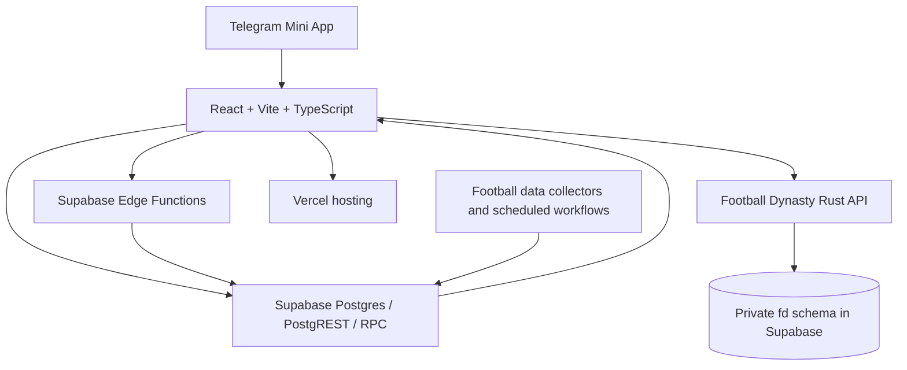

# Sherlock Scholes — Project Execution Map

> **Purpose:** keep the team focused on shipping a better football product and collecting trustworthy football data. This is an execution map, not a chronological work diary.
>
> **Last structure review:** 2026-11-11  
> **Canonical product:** Telegram Mini App — https://sherlock-scholes.vercel.app  
> **Repository:** https://github.com/Aloews/sherlock-scholes-  
> **Legacy map:** [Archived 2026-11-11](archive/MAP-2026-11-11-pre-outcome-rewrite.md)

## 1. Mission and product outcomes

Sherlock Scholes is a football product built around play, discovery, real football data, and useful analysis. Every engineering task must move at least one measurable product outcome:

1. **Play:** users can start and finish a game reliably, invite others, and return.
2. **Discover:** users can explore players, clubs, competitions, matches, and football stories.
3. **Understand:** player and team information is accurate, sourced, current, and comparable.
4. **Predict:** forecasts for matches, individual awards, and team competitions are calibrated against outcomes.
5. **Contribute:** users can create amateur football spaces without being able to alter other users' data.

A feature is not complete because its screen exists. It is complete when its user path works in production, its data is trustworthy, its failure states are handled, and its usage or quality can be measured.

## 2. Current product architecture

- **Frontend:** React, Vite, TypeScript, Feature-Sliced Design; route ownership is in `src/app/Router.tsx`.
- **Primary data platform:** the existing Supabase project. Real football data, Alias game data, and Football Dynasty fictional campaign data are separate domains.
- **Backend boundary:** existing features use Supabase RPC/PostgREST and Edge Functions. Football Dynasty has its own Rust/Axum API and private `fd` schema.
- **Hosting:** Vercel hosts the Mini App and the currently configured backend routing. Do not assume a Railway migration is complete unless the deployed service and production routes have been verified.
- **Scheduled collection:** GitHub Actions, Supabase Cron, and collector code. A successful job invocation does not prove that the upstream source returned complete or fresh data.

## 3. Delivery scoreboard

Update this section only from measured evidence. Every metric must include an observation timestamp and a source query, workflow, or dashboard.

| Outcome | Metric | Latest evidence in repository history | Status |
|---|---|---|---|
| Player discovery | Active cards with portraits / total active cards | 17,867 / 27,231 on 2026-11-07 12:50 UTC | Baseline is stale; remeasure |
| Player statistics | `player_season_stat` row count and latest `fetched_at` | 866,057 rows; latest fetch 2026-11-07 13:07 UTC | Collection is active in that snapshot; remeasure |
| Profile enrichment | Queue depth, success, no-data, retryable failures by source | 23,408 jobs on 2026-11-07 13:07 UTC | Transfermarkt had persistent zero-byte HTTP 202 responses; remeasure |
| Forecast quality | Brier score, log loss, calibration, coverage, baseline comparison | No current unified scorecard recorded here | Missing evidence |
| Player awards | Candidate coverage, feature freshness, calibrated probabilities, outcome evaluation | Snapshot tables and pipeline exist; current calibration not verified here | Needs measured evaluation |
| Team competitions | Tournament candidate coverage, calibrated probabilities, outcome evaluation | Snapshot tables and pipeline exist; current calibration not verified here | Needs measured evaluation |
| Reliability | Production release health, failed scheduled jobs, API readiness | Historical snapshots are dated 2026-11-07 | Remeasure before changing priorities |
| Product usage | Active users, game starts/completions, invitations, retention | No current baseline recorded here | Instrument and measure |

**Important:** the numbers above are historical evidence, not claims about today's production state. Never copy them forward as current values. Refresh the scoreboard before planning a data or reliability sprint.

## 4. Product areas and ownership map

| Product area | User outcome | Main entry points | Completion evidence |
|---|---|---|---|
| Home and navigation | Reach a useful football activity quickly | `src/screens/HomeScreen.tsx`, `src/app/Router.tsx` | Main journeys are discoverable; route and deep-link tests pass |
| Football Alias | Create/join a room and finish a multiplayer game | `src/screens`, `src/features/lobby`, game features | Host/guest lifecycle, reconnect, replay, and room expiry pass end-to-end |
| Player cards and profiles | Identify a player and inspect a reliable career record | `src/features/cards`, collection/profile screens | Identity, portrait provenance, career totals, and season totals reconcile |
| Clubs and squads | Inspect club identity, squad, form, and matches | `src/features/clubs`, club screens | Squad source, coverage, match sample size, and timestamps are visible and consistent |
| Matches and competitions | Follow fixtures, results, tables, and tournaments | `src/features/matches`, match/table screens | Fixtures and results reconcile; incomplete coverage is not presented as a full table |
| Statistics and ratings | Compare players on consistent definitions | `src/features/ratings`, statistics screens | One documented metric definition; no season/career mixing or duplicate pipelines |
| Forecasts | Make measurable predictions and learn from outcomes | `src/features/forecast`, `football_scraper/`, forecast tables | Time-correct snapshots, calibrated probabilities, settled outcomes, and benchmark reports |
| Awards and tournament analytics | Estimate likely award winners and competition outcomes | Candidate snapshot tables and forecast pipelines | Pre-event predictions are stored, evaluated out-of-sample, and calibrated |
| Fantasy | Build a team using the same trusted football statistics | `src/features/fantasy`, fantasy screens | Fantasy scoring reconciles to canonical match/player statistics |
| News and digest | Find relevant football stories with clear source attribution | `src/features/digest`, news screens | Source links, timestamps, deduplication, and clear separation of articles from video |
| Amateur football | Create and manage a private amateur league | `src/features/amateur`, `amateur-logo` Edge Function | Telegram identity verification, owner isolation, upload validation |
| Football Dynasty | Play a persistent fictional football dynasty campaign | `src/features/football-dynasty`, `src/screens/FootballDynastyScreen.tsx`, `services/football-dynasty` | Campaign lifecycle, ledger integrity, succession, persistence, and owner isolation |
| Admin and operations | Maintain data and resolve production issues safely | `src/screens/admin`, `docs/operations` | Audited changes, bounded jobs, observable failures, tested rollback |

This is a navigation index, not a promise that every listed area is currently complete. Verify implementation and production state before extending an area.

## 5. Data platform: source of truth and collection

### 5.1 Rules

- Every displayed football fact must have a defined source, identity mapping, observation time, and meaning.
- Never treat a successful HTTP response or queue status as proof that a player, club, squad, or statistic was successfully identified.
- Never replace a verified portrait or statistic with an unverified candidate.
- Keep **career totals**, **season totals**, and **single-match statistics** separate.
- Keep **real-world football entities** separate from fictional Football Dynasty entities.
- A missing value is not zero. An incomplete squad is not a complete squad. A partial set of player appearances is not a full league table.
- Store source provenance and fetch timestamps so stale data can be detected and corrected.

### 5.2 Core data domains

| Domain | Main relations / concepts | Required quality checks |
|---|---|---|
| Player identity and cards | `cards`, `players`, source identity mappings | Duplicate identities, ambiguous matches, active status, portrait provenance |
| Match-level performance | `player_match_stats`, fixtures and match relations | Match identity, player identity, duplicate rows, score and minutes sanity |
| Season performance | `player_season_stat`, season identifiers | Season boundaries, competition scope, team changes, source freshness |
| Clubs and squads | `football_club`, `club_roster`, `soccerwiki_player`, `club_match` | Squad completeness, effective dates, source disagreement, player movement |
| Market estimates | Market-value snapshots and source observations | Comparable dates, currency, age/league/position context, source confidence |
| Awards | `award_candidate_snapshot` and associated evaluation data | Only pre-award inputs; no leakage from future results |
| Team tournaments | `team_tournament_candidate_snapshot` and associated evaluation data | Tournament state, qualification, draw, injuries/availability where supported |
| Forecasts | Prediction snapshots, outcomes, calibration and error records | Timestamped probabilities, settled labels, baselines, calibration by horizon |

### 5.3 Collection pipeline

For each source, track:
1. **Coverage:** how many expected entities or competitions can be identified.
2. **Freshness:** age of the newest successful observation.
3. **Yield:** new verified facts written per run, not just jobs completed.
4. **Quality:** identity match rate, duplicate rate, field validation, and source conflicts.
5. **Cost and failure:** requests, runtime, rate limits, retries, blocked responses, and manual intervention.

A collector is healthy only when it produces net new, identity-verified data at an acceptable cost and freshness. A queue that repeatedly retries an upstream block is not progress.

## 6. Forecasting and analytics standard

All prediction systems must use one evaluation contract.

- Save the exact information available at prediction time.
- Store model version, feature version, prediction horizon, event/competition identity, probabilities, and creation time.
- Do not train or evaluate with information that became available after the prediction timestamp.
- Compare against transparent baselines (for example, market-implied probability where legally and technically available, simple historical frequency, or a naive benchmark).
- Report Brier score and log loss for probabilistic predictions; report calibration by probability bucket and sample size.
- Separate **coverage** (how often the model predicts) from **quality** (how accurate its predictions are).
- For abstaining models, report both quality on covered cases and coverage. Never compare them only on accuracy.
- Evaluate by competition, forecast horizon, season, and sample size. Do not claim superiority from a tiny sample.
- Personal awards and team tournaments must use the same principles but distinct feature sets and target definitions.

**Release gate:** no forecast feature is labelled accurate or calibrated until an out-of-sample evaluation report, sample size, baseline, and calibration result are available.

## 7. Football Dynasty boundary

Football Dynasty is a fictional management simulation inside Sherlock Scholes, not a source of real football statistics.

- Product specification: `docs/football-dynasty/GDD.md`
- Technical architecture: `docs/football-dynasty/ARCHITECTURE.md`
- Current implementation/release notes: `docs/football-dynasty/IMPLEMENTATION_PLAN.md`
- Rust API: `services/football-dynasty/`
- Frontend API and screen: `src/features/football-dynasty/`, `src/screens/FootballDynastyScreen.tsx`
- Persistence: private Supabase `fd` schema, owner-scoped through verified Telegram identity.
- Never write fictional players, clubs, competitions, or match results into the real football catalogue.
- The current implemented slice is campaign creation and a bounded founder/heir succession lifecycle. It is not the full management simulation described in the GDD.

## 8. Execution priorities

Work in this order. Reorder only when fresh production evidence shows a higher-impact blocker.

### P0 — Restore a reliable shipping and measurement loop

**Outcome:** every week produces a user-visible improvement or a verified data-quality/reliability fix.

- Establish a current production baseline for release health, core journeys, active users, game starts/completions, collection yield, and forecast quality.
- Identify the smallest production blocker that prevents a feature or data pipeline from shipping.
- Keep changes small enough to review and deploy independently.
- Remove stale or contradictory roadmap items; do not keep multiple competing implementations alive.
- Maintain a weekly shipped-outcome log with links to PRs, deployments, tests, and measured impact.

**Exit criteria:** the baseline exists; the top blockers have owners and acceptance tests; the next deliverable can be released without bundling unrelated refactors.

### P1 — Increase the amount of trustworthy football data

**Outcome:** materially more verified player, squad, match, and season data is available to product features.

- Measure coverage gaps by competition, club, season, and player—not only total row counts.
- Prioritise sources by verified yield and reliability. Do not blindly increase request volume against blocked sources.
- Resolve stale leases, retry loops, source-specific failures, identity mismatches, and incomplete squad ingestion.
- Preserve existing verified photos and records; fill missing data without destructive replacement.
- Publish a collection report after each bounded run: attempted, verified new, updated, unchanged, rejected, retryable, and permanently unavailable.

**Exit criteria:** measurable net growth in verified coverage, freshness within an agreed window, and no increase in duplicate or identity-error rates.

### P2 — Unify football statistics and market estimates

**Outcome:** every screen and model uses the same definitions and canonical facts.

- Establish canonical definitions for career totals, season totals, match totals, appearances, minutes, goals, assists, and market-value observations.
- Reconcile source conflicts and team/competition scope.
- Ensure player cards, ratings, fantasy, forecasts, and club screens consume the same canonical layer.
- Add regression tests for known player/club discrepancies before changing production calculations.

**Exit criteria:** agreed discrepancy cases pass; no screen silently substitutes season totals for career totals; every displayed metric has a definition and provenance.

### P3 — Ship calibrated player-award and team-tournament forecasts

**Outcome:** the product can rank plausible winners before an event and show how those predictions performed afterwards.

- Define targets and prediction horizons for each award and tournament.
- Build leakage-safe candidate snapshots from information available at prediction time.
- Produce probability distributions, not unsupported deterministic rankings.
- Backtest by historical season and competition; compare with simple baselines.
- Store final outcomes and publish calibration, Brier score, log loss, coverage, and sample sizes.
- Surface uncertainty and missing data in the UI.

**Exit criteria:** reproducible out-of-sample evaluation and a production monitoring path exist for both personal awards and team competitions.

### P4 — Expand product features from measured demand

**Outcome:** new features increase meaningful usage rather than adding disconnected screens.

- Prioritise features that improve a core journey: play, discover, understand, predict, or contribute.
- Require a one-sentence user problem, a production acceptance path, a data dependency check, and a success metric before implementation.
- Prefer one complete vertical slice over several partially integrated features.
- Defer cosmetic refactors unless they remove a measured usability problem or unblock delivery.

**Exit criteria:** each feature is used by a real user path and has a metric that can confirm or reject its value.

## 9. Definition of done

A task is done only when all applicable items are true:

- [ ] User outcome and acceptance criteria are explicit.
- [ ] Existing code, data, and production behaviour were inspected before changes.
- [ ] One canonical implementation is used; no parallel duplicate pipeline was added.
- [ ] Authorization, ownership, and data provenance are enforced server-side.
- [ ] Tests cover success, failure, boundary, and regression cases.
- [ ] Relevant CI checks pass on the exact commit being released.
- [ ] Deployment is verified against the intended commit and production URL.
- [ ] Critical user journey is smoke-tested in the real Telegram Mini App.
- [ ] Data freshness, collection yield, or feature usage is measured where relevant.
- [ ] Documentation reflects the deployed code, not an intended future state.

Do not report a task as complete based only on code being merged, a workflow being green, or a deployment being marked ready.

## 10. Repository navigation

| Need | Start here |
|---|---|
| Route registration and app shell | `src/app/Router.tsx`, `src/app/` |
| Screens | `src/screens/` |
| Domain features and API clients | `src/features/` |
| Shared UI, hooks, utilities | `src/shared/` |
| Supabase schema and migrations | `supabase/migrations/` |
| Edge Functions | `supabase/functions/` |
| Football data collection and analytics | `football_scraper/`, `scripts/`, `docs/*.py` |
| Rust Football Dynasty service | `services/football-dynasty/` |
| Product specification | `docs/football-dynasty/GDD.md`, feature-specific specs |
| Technical constraints | `docs/ARCHITECTURE.md` |
| Content rights and attribution | `docs/CONTENT_RIGHTS.md` |
| Historical production investigations | `docs/archive/MAP-2026-11-11-pre-outcome-rewrite.md` |

Do not scan the entire repository by default. Start with the relevant entry point, feature API, database contract, and tests. Expand the search only when the code contradicts this map or a dependency is not listed.

## 11. Working agreement for AI agents and contributors

1. Read this map and the relevant feature specification before implementation.
2. Inspect the current branch, open PRs, CI, migrations, production state, and recent deployments before changing anything.
3. State the expected user outcome and acceptance criteria in the PR.
4. Implement the smallest complete vertical slice.
5. Run targeted tests first, then required repository checks.
6. Inspect the actual diff and test output; fix failures rather than explaining them away.
7. Verify production behaviour and data impact after deployment.
8. Update this map only when architecture, ownership, a release gate, or a measured priority changes. Do not append routine audit logs here.
9. Put dated investigations, raw counts, incident timelines, and detailed query output in a dedicated operational report under `docs/archive/` or `docs/operations/`.
10. Never invent metrics, claim unverified deployment success, weaken tests to get a green check, or delete production data to make a dashboard look healthy.

## 12. Immediate next deliverables

These are the next outcomes to prove—not a promise that work is already complete:

1. **Fresh baseline:** remeasure production deployment, key user journeys, player/photo/stat coverage, collection yield, cron and GitHub workflow failures, and database capacity.
2. **Data recovery plan:** turn the largest verified collection gaps into bounded, source-specific fixes with measurable net-new data targets.
3. **Canonical analytics contract:** document and test the shared definitions used by cards, ratings, fantasy, player awards, and team tournament forecasts.
4. **Forecast evaluation report:** produce the first leakage-safe, out-of-sample scorecard for individual awards and team competitions.
5. **Feature delivery cadence:** ship one complete, measurable user-facing vertical slice at a time; do not let infrastructure cleanup consume the entire release cycle.

**Priority rule:** if a task does not improve a user journey, increase verified data coverage/freshness, improve measured prediction quality, or remove a demonstrated production blocker, it is not a top-priority task.

## 13. Autonomous Execution Protocol — Mandatory

This section is the operating contract for all AI development agents and contributors working on Sherlock Scholes. It must be followed together with the safety, data-quality, and release requirements elsewhere in this map.

### 13.1 Responsibility model

**Product owner (user):**
- Acts as the customer and final product acceptance tester.
- Reviews the complete product and its principal user journeys.
- Reports product-level defects or unmet expectations.
- Is not responsible for supervising individual commits, choosing implementation details, tracking routine progress, or coordinating engineering tasks.

**Execution team (AI agents and connected engineering tools):**
- Owns repository inspection, technical planning, architecture decisions, implementation, code review, QA, regression, data-quality checks, CI, deployment preparation, production verification, and documentation.
- Must inspect the actual repository, connected services, current production state, and available evidence before acting.
- Must make reversible, evidence-based technical decisions independently.
- Must maintain a resumable execution state in GitHub so work does not depend on one chat session.

The user's role as final tester does not waive security, privacy, data-integrity, or production-release safeguards.

### 13.2 Communication policy: no routine progress messages

Do not send intermediate progress reports, percentage-complete updates, implementation diaries, or messages announcing routine phase transitions.

Continue autonomously through diagnosis, implementation, testing, failure analysis, correction, and retesting. Report only when:
1. A decision or action is objectively blocked by information or authority that only the user can provide;
2. A material risk requires explicit product-owner approval (especially irreversible data, security, billing, or externally visible product changes); or
3. The agreed deliverable has passed its applicable release gates and is ready for final acceptance.

When a blocker occurs, first inspect the code, Git history, documentation, CI logs, service configuration, and other authorized evidence. Do not ask the user to repeat information already available in the repository or connected systems. Ask one concise, specific question only when autonomous resolution is not safe or possible.

### 13.3 Autonomous execution loop

For each deliverable, the execution team must:

1. Read this map and the relevant product/technical specifications.
2. Inspect the current main branch, active branches and PRs, recent commits, CI runs, Supabase migrations and schema contracts, Vercel/Railway deployment state, and relevant production behaviour.
3. Establish the existing behaviour and data state before modifying them.
4. Define user-visible acceptance criteria, technical invariants, data-safety constraints, and rollback conditions.
5. Implement a complete, reviewable vertical slice. Avoid unrelated refactors and duplicate implementations.
6. Run focused unit, integration, database, security, and end-to-end tests as applicable.
7. Inspect test output, logs, diffs, migration plans, and generated artifacts. A command exit code alone is not sufficient evidence.
8. Fix failures and repeat the affected checks until they pass or a genuine external blocker is established.
9. Verify the deployed commit, production health, critical user journeys, and relevant persisted data after release.
10. Update this map and the relevant operational records with verified state, links, timestamps, and remaining blockers.

A failed check is a work item, not a reason to stop and send a progress message.

### 13.4 Resumability and source of truth

- GitHub is the durable execution record; chat history is not the project state store.
- docs/MAP.md is the canonical high-level project map and operating contract.
- Keep implementation details, task checklists, evidence, test results, and handoff notes in their appropriate feature specifications, PRs, issues, or docs/operations/ reports.
- Every active workstream must have a concrete next action, acceptance criteria, current evidence, and a clear blocked/not-blocked state.
- Before ending a work session, persist the exact branch, commit, completed checks, failed checks, deployment state, and next executable action. Never mark an unverified item complete.
- On resumption, reconstruct state from GitHub and connected systems; do not rely on recollection or ask the user to restate the task.

### 13.5 Work status lifecycle

Use explicit evidence-based states for each migration area and major feature:

| State | Meaning |
|---|---|
| NOT_ASSESSED | Existing implementation and behaviour have not yet been inspected. |
| ASSESSED | Existing behaviour, dependencies, risks, and acceptance criteria are documented. |
| IMPLEMENTED | The target implementation exists; this state does not imply that tests pass. |
| UNIT_TESTED | Relevant unit and component tests pass on the recorded commit. |
| INTEGRATION_TESTED | API, database, service, and external-boundary tests pass as applicable. |
| REGRESSION_TESTED | Existing supported journeys and previously fixed defects pass regression checks. |
| PRODUCTION_VERIFIED | The exact deployed commit and real production behaviour have been verified. |
| BLOCKED | A specific external dependency, permission, unavailable service, or owner decision prevents safe progress; evidence and the unblock condition are recorded. |

Never infer a later state from an earlier one. Record the commit SHA, test/workflow links, and verification timestamp for PRODUCTION_VERIFIED.

### 13.6 Full Rust migration objective

The strategic engineering objective is to migrate the Sherlock Scholes application to a Rust-centred implementation, covering the complete application and its business logic rather than only the Football Dynasty service.

- Inventory every existing screen, route, user journey, API, Edge Function, scheduled job, collector, worker, domain rule, and integration before declaring migration coverage.
- Map each existing capability to its Rust target, data contract, authorization boundary, tests, and production acceptance criteria.
- Preserve the existing Supabase project, PostgreSQL data, Telegram identity and authorization model, and user-facing behaviour unless a separately approved change is required.
- Treat the existing React/TypeScript client, Edge Functions, Python collectors, and other non-Rust components as legacy or compatibility components to be migrated, replaced, or explicitly justified—not as silently completed Rust work.
- Respect Telegram Mini App and browser runtime constraints. Any non-Rust component retained for a concrete platform requirement must be documented with its reason, owner, interface, and retirement condition.
- Do not rewrite or remove a working subsystem before its replacement has equivalent behaviour, data compatibility, security controls, observability, and tested rollback.
- Use incremental, independently verifiable migration slices. Do not perform a destructive big-bang cutover.

The migration inventory must track each capability through the lifecycle in §13.5. The target is complete application coverage, not merely a compiling Rust backend.

### 13.7 Branch, PR, CI, and production rules

- Use isolated branches and pull requests for reviewable changes. Do not make routine implementation commits directly to main.
- Group related changes into coherent delivery packages; avoid a stream of tiny PRs and avoid bundling unrelated changes.
- Do not merge a PR while required checks are failing, pending, missing, or attached to a different head commit.
- Review the complete diff, migration effects, permissions, generated files, and test evidence before merge.
- Do not bypass branch protection, weaken tests, suppress failures, or change release gates merely to obtain a green status.
- Do not apply unverified or unreconciled database migrations to production.
- Do not run expensive or unbounded parsers, collectors, queue resets, destructive SQL, or production data deletion without bounded scope, measured cost, and an explicit safety case.
- Release only a commit whose checks and migration plan have been verified. Confirm the actual production deployment SHA and smoke-test the real Telegram Mini App.
- A green build or READY deployment status alone is not proof of product readiness.

### 13.8 Mandatory production release gate

A full-product release cannot be declared ready until every applicable capability is PRODUCTION_VERIFIED and all critical gates below have evidence:

- [ ] Complete inventory of legacy screens, routes, features, services, workers, collectors, and scheduled jobs.
- [ ] Every supported legacy user journey has an implemented and tested Rust-target equivalent, or a documented platform-constrained exception with an approved retirement plan.
- [ ] Telegram authentication, identity binding, authorization, ownership isolation, and session lifecycle work in production.
- [ ] Game rooms, invitations, reconnects, replay, expiry, and multiplayer lifecycle pass end-to-end tests.
- [ ] Player cards, portraits, clubs, squads, matches, statistics, and market estimates pass identity, provenance, freshness, and reconciliation checks.
- [ ] Forecasts, individual awards, team tournaments, and fantasy use verified data contracts and measured evaluation.
- [ ] Collectors, parsers, scheduled jobs, queues, and background workers have bounded execution, observable failures, and verified data yield.
- [ ] Football Dynasty is integrated without mixing fictional and real-football data domains.
- [ ] Starimg is the only AI gateway; no unapproved direct model-provider path or hidden fallback remains.
- [ ] Supabase data is preserved; schema migrations, RLS, grants, backups, and restore procedures are verified.
- [ ] No critical user journey or required capability has been lost.
- [ ] Unit, integration, database, security, regression, and end-to-end checks pass on the release commit.
- [ ] Load, resilience, and security checks meet documented acceptance thresholds.
- [ ] Production runs the exact verified release commit and critical journeys have been tested in the real Telegram Mini App.
- [ ] Legacy implementations are retired only after equivalent production behaviour and rollback safety are proven.

A checklist item is not complete because it is planned, coded, merged, or marked green in isolation. Attach evidence to every completion claim.

### 13.9 Escalation and safety boundary

Proceed independently when a safe, reversible, evidence-supported path exists. Escalate only when:
- required credentials, permissions, or owner-only actions are unavailable;
- two materially different product behaviours are plausible and repository evidence cannot resolve the intended one;
- a proposed action risks irreversible data loss, privacy exposure, security weakening, unexpected cost, or disruption to an unrelated service;
- a required third-party service or platform capability is unavailable and no compliant alternative exists.

Never fabricate access, credentials, test results, data freshness, deployment status, or completed work. Never modify unrelated services or delete user data as a shortcut.

### 13.10 Final handoff

The final report is delivered only after the agreed release scope has passed its gates. It must contain:
- the production URL and exact deployed commit;
- the Rust migration coverage and any explicitly approved exceptions;
- links to merged PRs and CI evidence;
- verified critical user journeys and production smoke-test results;
- data-quality and security verification results;
- known limitations and any remaining blockers;
- a clear request for the user's final whole-product acceptance test.

Do not send a completion announcement while any mandatory release gate remains unverified.

### 13.11 Execution does not depend on ChatGPT Work

ChatGPT Work is an optional execution environment, not a prerequisite, dependency, or user setup requirement for this project.

- The product owner must not be instructed to locate, open, configure, or transfer the task into Work as a condition for development to proceed.
- When repository and integration tools are available in the current ChatGPT session, the assistant may execute authorized GitHub work directly from the conversation: inspect repository state, read and edit files, create branches and pull requests, inspect CI evidence, and use connected service tools within their granted permissions.
- The assistant must first discover which tools and permissions are actually available. It must not imply that access to GitHub, Supabase, Vercel, Railway, production credentials, or deployment controls exists unless confirmed by tool results.
- GitHub remains the durable source of truth for project instructions, migration inventory, issues, pull requests, commits, CI results, release evidence, and resumable next actions. No essential project state may exist only in chat history or an ephemeral Work session.
- A chat session is an interactive execution window, not a continuously running process. The assistant cannot promise to keep executing after the session ends, autonomously wake itself, or guarantee uninterrupted work between turns unless a separately configured and verified execution mechanism provides that capability.
- At the end of each actual work session, persist a precise handoff in GitHub: current branch and commit, work completed, checks and their evidence, unresolved failures, deployment state, blockers, and the next executable task.
- When the user returns in a new conversation and asks to continue, reconstruct the state from GitHub and connected services, then resume from the recorded next action. Do not ask the user to repeat project context already stored there.
- GitHub Actions and other verified automation may run bounded checks or scheduled jobs. They are not a substitute for an implementation agent with repository permissions, and their existence must not be represented as proof of continuous autonomous development.
- If an external long-running agent or cloud workspace is later configured, treat it as an optional execution worker. It must read and obey this map, write durable progress to GitHub, and meet the same security and release gates. The product owner should not have to operate that environment manually.

**Operating conclusion:** development can proceed from the current ChatGPT conversation using the tools actually connected here. Work is optional. Continuity is provided by GitHub records and verified automation; uninterrupted background execution must never be promised unless it is demonstrably configured and running.

### 13.12 Operational checks and configuration ownership

The execution team owns routine operational verification. The product owner is not the deployment operator, environment-variable auditor, build coordinator, or first-line infrastructure troubleshooter.

- Before asking the product owner to do anything, inspect the connected provider configuration, project/service/environment scope, deployment history, build logs, runtime logs, health checks, and repository deployment configuration using the tools already authorized.
- For every required environment variable, verify its **name, presence, scope, target service, and target environment**. Never request or expose secret values in chat. Distinguish service-level variables from shared/environment-level variables and check whether the consuming process can actually receive the variable.
- When a configuration change is detected, determine whether it requires a rebuild, redeploy, restart, or no action. Do not assume that saving a variable automatically updates an already-running deployment.
- If the required action is authorized, safe, and within the agreed cost boundary, perform it directly. Then verify that a new deployment was created from the intended source commit, the build completed, the service became healthy, and the runtime can use the configuration. A deployment marked successful is not enough if runtime verification is possible.
- If the provider requires a manual action that the connected tools cannot perform, exhaust available read-only diagnostics first. Ask the product owner only for that specific provider-side action, explaining exactly why it cannot be performed by the execution team. Never ask them to perform routine checks that the team can do itself.
- Treat missing, mis-scoped, unavailable, or unapplied configuration as an engineering diagnosis to resolve—not as evidence that the product owner made a mistake.
- Before declaring an integration ready, test the actual integration path with the configured service, inspect sanitized response/error evidence, and verify failure handling. Do not print credentials, tokens, authorization headers, or secret-bearing environment output in logs, PRs, or reports.
- Apply the same ownership rule to build triggers, deployment restarts, health checks, domain/routing configuration, scheduled jobs, queue workers, and provider-side service status.
- Keep all operational actions within the approved project, environment, permissions, and cost limits. Do not trigger paid resources or irreversible production changes without the required approval.

**Acceptance rule:** a configuration-related task is complete only when the execution team has verified the effective configuration scope, applied any required rebuild/redeploy/restart, and checked the resulting runtime behaviour—or recorded a concrete provider-side blocker that genuinely requires the product owner's action.
